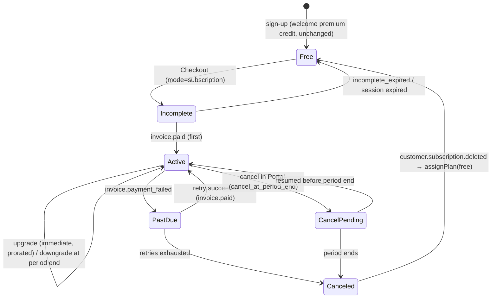

# Mawica: Stripe integration, Phase 1 architecture audit and plan

| | |
|---|---|
| Date | 27 November 2026 |
| Branch audited | `feature/hero-copy-readability` at `b52d9eb` (admin branches reviewed separately, see §1.8) |
| Scope | Audit and planning only. No application code, dependencies, Stripe objects, payments, migrations, Azure resources or commits were changed. |
| Stripe mode | Sandbox / test mode only |
| Status | **Awaiting owner approval before Phase 2** |

---

## 0. Limitations of this audit (read first)

1. **The Stripe MCP planner was not available.** The Stripe plugin is enabled on the claude.ai account, but plugins load when a session starts and this session started before it was added. `stripe_implementation_planner` could not be called. Section 2 is therefore based on Stripe's published best practice for Checkout, Billing, Customer Portal, webhooks, Invoicing and Radar, **not** on planner output. Before Phase 2 begins, re-run the planner in a fresh session (with the MCP signed in via `/mcp`) and record any differences in an addendum to this document.
2. **The connected Stripe account could not be confirmed.** The Stripe CLI (1.55.15) is installed but not logged in (`stripe config --list` shows no account), and there is no MCP connection. **Nothing in this audit confirms that the target account is the new dedicated MAWICA account rather than the Mercor account.** This is a Phase 2 GO criterion (§14).
3. No secret values were read, requested or displayed. Only environment variable *names* were inspected.

---

## 1. Current architecture findings

### 1.1 Stack (verified against `node_modules`)

| Component | Reported | Installed | Notes |
|---|---|---|---|
| Next.js | 16.4.5 App Router | **16.4.5** | `proxy.ts` (not middleware), route handlers under `src/app/api` |
| Prisma | 7 | **7.10.1** (`prisma`, `@prisma/client`) | `prisma-client` generator, output `src/generated/prisma` (gitignored), `@prisma/adapter-pg` |
| PostgreSQL | yes | yes | Local DB must use port 5433 (`src/lib/db-guard.ts`); remote DB only when `NODE_ENV=production` |
| Better Auth | 1.7 | **1.7.19** | Email OTP only (`src/lib/auth.ts`), Prisma adapter |
| Zod | yes | **4.6.7** | Env schema in `src/lib/env.ts`, request schemas in `src/modules/*/schema.ts` |
| Node | | `>=22.18.0` (local 26.3.1) | |
| Stripe | none | **none** | No `stripe` dependency and no Stripe code anywhere on HEAD |

### 1.2 Customer accounts and authentication
- `User`, `Session`, `Account`, `Verification` and `AuthRateLimit` are Better Auth tables (`prisma/schema.prisma:86-168`). Mawica-owned data lives in `Profile`, `AccountSettings` and `AuditLog`.
- Server-side session helpers: `getSessionUser()` for pages and `getRequestUser(request)` for routes (`src/modules/auth/session.ts`). Both validate against the database.
- Mutating routes check the session, then `isAllowedOrigin` (which refuses a missing Origin header, `src/modules/auth/request.ts:24`), require `content-type: application/json` and, for spends, an `Idempotency-Key`. **A Stripe webhook route must not use the origin helper**, because Stripe sends no Origin header.
- `AuditLog` is append-only in spirit and stores HMAC'd IPs, never PII. It is suitable for billing audit events.

### 1.3 Membership / plans
- Plans are data: `Plan` (key, name, active, `purchasable`, sortOrder) and `PlanEntitlement` (planKey, key, value, period).
- Seeded in `prisma/migrations/20261110133003_card_wallet/migration.sql:212-224`:

| Plan | sends.total | sends.premium | welcome.premium | schedule.months_ahead | purchasable |
|---|---|---|---|---|---|
| `free` | 10 / MONTH | none | 1 / LIFETIME | 1 | false |
| `plus` | 50 / MONTH | 5 / MONTH | none | 12 | false ("until the payments phase") |

- `CreditAccount.planKey` is the account's current plan. **There is no subscription model**, no billing customer, no order, no invoice and no price mapping.
- `assignPlan(tx, accountId, planKey, now)` (`src/modules/wallet/wallet.ts:104`) is the only path that changes a plan. No route calls it; it is marked as reserved for "the future payments phase". It expires the old plan's period grants and creates new ones minus what was already consumed in the current period.

### 1.4 Wallet and transaction ledger: **authoritative, keep it**
This is a well-engineered system and should stay the single internal record of credits (`docs/wallet.md`, `src/modules/wallet/engine.ts`):
- Balances live in `CreditGrant.remaining`, protected by `CHECK (0 <= remaining <= amount)`, and change only through conditional decrements on `FOR UPDATE` rows.
- `LedgerEntry` is append-only (a database trigger blocks UPDATE, DELETE and TRUNCATE). `reconcile()` proves `remaining = SUM(delta)` for each grant.
- `grantCredit()` is idempotent through `@@unique([accountId, grantKey])`. **The documented key format already anticipates payments: `"purchase:<order>"`**.
- The enums already include `GrantSource.PURCHASE`, `GrantSource.ADJUSTMENT`, `LedgerKind.REFUND`, `LedgerKind.ADJUST`, and the `EntitlementPeriod` values `SUBSCRIPTION_YEAR` and `EVENT`.
- Reservations (`HELD → COMMITTED | RELEASED`, enforced by a trigger) are keyed by `(accountId, idempotencyKey)` with a canonical `requestHash`.

### 1.5 Premium credits and entitlements
- A standard send costs 1 TOTAL. **A premium send costs 1 TOTAL plus 1 PREMIUM**, taken atomically. Credits that expire soonest are spent first; the welcome credit is spent last.
- The welcome premium credit is granted once per verified email, ever, guarded by `WelcomeGrantTombstone` (an HMAC using `WELCOME_PEPPER`). **This must be preserved unchanged**, and Phase 2+ must not touch it.
- Periods are anchored to `CreditAccount.periodAnchor` (the account anniversary, "never changes") and are created lazily by `ensurePeriodGrants()`. There is no reset job.
- `loadEntitlements()` **refuses** unlimited values (`NULL`) and the periods `SUBSCRIPTION_YEAR` / `EVENT` (`src/modules/wallet/entitlements.ts:34-37`). Unlimited, Corporate pools and Event are therefore not supported by the engine yet.
- A card's tier is resolved on the server from the template registry (`templateTier()`), never from the client.

### 1.6 Card creation and publishing
- `POST /api/cards` → `publishOwnedCard()` (`src/modules/wallet/publish.ts`): reserve, create the card, commit, all in **one transaction**. Out of credit returns **HTTP 402** with `INSUFFICIENT_CREDITS` / `INSUFFICIENT_PREMIUM_CREDITS` (`src/app/api/cards/route.ts:87-90`). That 402 is the natural "upgrade or buy" entry point for Checkout.
- Scheduled sends reserve credits through the same engine (`src/modules/scheduling`, `src/modules/delivery`). The delivery worker is CLI only and not deployed.

### 1.7 Corporate and event packages
- **Neither exists in code.** There is no organisation/team/seat model, no event model and no RSVP. The schema comment at `prisma/schema.prisma:255` lists them as "future rows".

### 1.8 Admin customer management, finance and analytics
- The untracked `admin/` folder on this branch holds **only build leftovers**: `node_modules`, `.next`, and `admin/.env.local` (git-ignored, verified with `git check-ignore`). It contains no source.
- The real admin app lives on **unmerged** branches `feature/admin-p0-p1` → … → `feature/admin-deployment-r1` (about 178 files and 21.5k lines). It is a separate Next.js app (`admin.mawica.com`, port 3010) that shares the Prisma schema and database. It has:
  - Entra ID OIDC staff sign-in, `StaffPrincipal`, and roles OWNER / MODERATOR / SUPPORT / **FINANCE** / OPS / READONLY, with permissions including `wallet:read`, `wallet:adjust`, `finance:read` and `finance:plan`.
  - A read-only customer directory with wallet and ledger views. `wallet:adjust` exists but has **no UI or API**.
  - A `/finance` page with **projections only**, labelled "not actual revenue … or Stripe settlements".
  - 4 extra migrations (`staff_admin`, `cms_*`) that are **not on HEAD**. `src/generated/prisma` currently contains `Cms*` and `StaffPrincipal` models because it was generated on an admin branch. Regenerate it before Phase 2 work.
- `scripts/admin.mts` (on HEAD) is a break-glass CLI with card removal, reports and purges. It has **no** credit or plan operations.

### 1.9 Azure deployment and secret management
- Staging only: Azure **Container Apps** (`ca-mawica-stg`, resource group `rg-mawica-staging-aue`), private Postgres in a VNet, and **Key Vault** secrets referenced as Container Apps secrets through a user-assigned managed identity with per-secret grants (`infra/staging/app.json`). Required secrets are checked before deploy by `infra/staging/web_params.py`.
- Migrations run as a Container Apps job (`caj-mawica-stg-migrate`) with `prisma migrate deploy`, gated in `.github/workflows/deploy-staging.yml`. CI uses GitHub OIDC and stores no secrets.
- **No production infrastructure exists yet.** `docs/release-gates.md:40` records: "Payment decision: no payment integration is in scope". This gate must be formally reopened.
- `next.config.ts:16` sends `Permissions-Policy: payment=()`. This is harmless for **hosted** Checkout, because the payment happens on `checkout.stripe.com`. It would need revisiting only if Stripe Elements or the Payment Request API is embedded on mawica.com.

### 1.10 Environment files and Git (verified)
- `.gitignore:34` contains `.env*` with the exception `!.env.example`. `git check-ignore` confirms that `.env.local` and `admin/.env.local` are ignored. `.env.example` is committed and holds fake values only.
- `src/lib/env.ts` validates `process.env` with Zod and reports only bad key *names*. That is the right place for the Stripe variables.
- **Note:** the `NEXT_PUBLIC_*` variables are inlined at build time. If Phase 2 uses hosted Checkout (a server redirect), `NEXT_PUBLIC_STRIPE_PUBLISHABLE_KEY` is **not needed at all** and can be left unset until embedded UI is required.

---

## 2. Stripe recommendations (best practice; planner unavailable, see §0)

| Area | Recommendation for Mawica |
|---|---|
| Payment UI | **Stripe-hosted Checkout Sessions** for both one-time purchases (`mode=payment`) and subscriptions (`mode=subscription`). Nothing on mawica.com touches card data (PCI SAQ A). Radar, 3DS/SCA, Apple Pay and Google Pay are included. |
| Products & prices | Create them once in test mode with a reviewed, idempotent setup script that uses **`lookup_key`s** (for example `mawica_plus_monthly_aud`). The server resolves lookup key → price ID. The client sends only a product code from an allowlist, never a price, amount or price ID. |
| Currency | AUD only (`currency: 'aud'`). Store amounts as integer cents. |
| Customer | One Stripe Customer per Mawica `User`, created lazily on first checkout. Record `metadata.mawica_user_id`, and pass `client_reference_id` plus metadata on every Checkout Session and subscription. |
| Subscriptions | Billing with monthly and annual prices on the same product. Upgrades take effect immediately with proration. Downgrades and interval changes take effect **at period end** (subscription schedules or Portal setting). Cancellation takes effect at period end. |
| Customer Portal | Use the Stripe-hosted Billing Portal for payment-method updates, invoice history, cancellation and plan switching, configured to allow only Mawica plan prices. |
| Fulfilment | **Webhooks are the source of truth**. The success page only shows status and never grants credits. Verify signatures on the raw body, store each `event.id` once, process inside a database transaction, and return 2xx quickly. |
| Failed payments | Smart Retries, plus Stripe's failed-payment and card-expiry emails. Subscription status goes `past_due` → `unpaid`/`canceled` according to the retry settings. Mawica revokes paid entitlements on `customer.subscription.deleted` (or at the end of a grace period, see the decisions in §13). |
| Invoicing | Corporate customers can pay by invoice (`collection_method=send_invoice`, `days_until_due`) on a subscription or as a one-off invoice created by staff. Reuse the same webhook pipeline (`invoice.paid`). |
| Radar | Keep Radar's default rules. Add rules to block on failed CVC and failed postcode checks, and send elevated-risk payments to review. Handle `radar.early_fraud_warning.created` by refunding and revoking proactively. Rate-limit Mawica's own checkout-session endpoint to blunt card-testing. |
| Tax | **`automatic_tax` disabled**, with no Stripe Tax until GST obligations are confirmed (§13). |
| Keys | Prefer a **restricted key** (`rk_test_…`) limited to the resources used over a full secret key. Use separate keys and a separate webhook endpoint secret per environment. |
| API version | Pin the API version via the stripe-node client at install time and upgrade deliberately. |

---

## 3. Existing reusable models and services

| Reuse | For |
|---|---|
| `CreditAccount`, `CreditGrant`, `LedgerEntry`, `grantCredit()` | All credit fulfilment (`source: PURCHASE` / `PLAN_PERIOD` / `ADJUSTMENT`), with deterministic `grantKey`s derived from Stripe IDs |
| `Plan` / `PlanEntitlement` | Plan catalogue. Add rows for `corporate`, `unlimited` and `event`. Flip `purchasable` per plan when it goes live |
| `assignPlan()` | Plan changes driven by subscription webhooks (with the period changes in §5) |
| `reconcile()` | Extend with Stripe ↔ ledger reconciliation |
| `WelcomeGrantTombstone` + `ensureWallet()` | Unchanged; the complimentary premium card for Free customers is preserved |
| `AuditLog` | `billing.*` audit actions (no PII, no card data) |
| `requestHash()` / Idempotency-Key pattern | Checkout-session creation endpoint |
| `rate-limit.ts`, `client-hash.ts` | Throttling checkout and portal session creation |
| `getRequestUser`, `isAllowedOrigin` | Ownership and CSRF on user-facing billing routes |
| `src/lib/env.ts` | Stripe env validation |
| Key Vault + Container Apps `secretRef` pattern, `web_params.py` | Stripe secrets in staging and production |
| Admin app RBAC (`FINANCE` role, `wallet:adjust`), on its branch | Finance reporting, refunds and adjustments once merged |

---

## 4. Architecture gaps

| # | Gap | Impact |
|---|---|---|
| G1 | No billing customer, subscription, order, invoice or webhook-event tables | Required for mapping and idempotency |
| G2 | **Period anchor mismatch**: wallet periods are anchored to the account anniversary, while Stripe periods are anchored to subscription start | Paid allowances would reset on a different day from billing. Paid plans must anchor to the subscription (§9) |
| G3 | Annual plans: the engine refuses `SUBSCRIPTION_YEAR`, and `docs/wallet.md` says "Annual Plus gets monthly allowances" | Monthly allowance slices must be generated from the subscription anchor during an annual term |
| G4 | **A premium send needs 1 TOTAL + 1 PREMIUM** | A Free user who buys a single premium card but has used all 10 monthly sends could not use it. The purchase must grant both units, or the rule must change |
| G5 | Unlimited (`NULL`) values are refused by `loadEntitlements` | The Unlimited plan needs engine support and a fair-use cap |
| G6 | No organisation, team or seat model | Corporate cannot be "corporate" (shared pool, multiple senders) without one |
| G7 | No event model, and the `EVENT` period is refused | The Event package has nothing to attach to |
| G8 | `LedgerKind.REFUND` means a *positive* restore to the customer | A money refund that **claws back** credits needs `ADJUST` (negative delta, `reason: refund:<id>`) and a rule for credits already spent |
| G9 | Admin app is unmerged, and finance is projection-only | Real finance reporting depends on merging the admin branches first |
| G10 | `release-gates.md` says payments are out of scope, and there is no production infrastructure | Governance: the gate must be reopened and production Key Vault created before live mode |
| G11 | No pricing page; marketing copy says "Free to create" / "without paying a cent" | Copy, Terms and Privacy must be updated before launch (Stripe as processor, refunds, auto-renewal) |
| G12 | Admin finance placeholders (branch `admin/src/modules/staff/finance/defaults.ts`) contradict the approved pricing (for example Corporate $199 vs approved $20, Event $249 vs $60) | Replace them with Stripe or DB prices to avoid two sources of truth |
| G13 | `src/generated/prisma` was generated from an admin branch | Regenerate before work starts so types match HEAD |

---

## 5. Proposed database changes (Phase 2+, for review; **not applied**)

All new tables have a `livemode Boolean` column and timestamptz columns. Stripe IDs are `VarChar(255)` and `@unique`. Nothing stores card numbers, CVC or bank details (only the brand and last 4 digits if ever needed for display, and preferably not even those).

```prisma
/// One Stripe customer per Mawica user per mode. Separate table: Better Auth tables stay untouched.
model BillingCustomer {
  id               String   @id @default(dbgenerated("gen_random_uuid()")) @db.Uuid
  userId           String?  @db.Uuid          // SetNull on user deletion (finance records retained)
  accountId        String   @db.Uuid          // CreditAccount
  stripeCustomerId String   @unique @db.VarChar(255)
  livemode         Boolean
  createdAt        DateTime @default(now()) @db.Timestamptz(3)
  @@unique([userId, livemode])
}

enum BillingInterval { MONTH YEAR }
enum SubscriptionStatus { INCOMPLETE INCOMPLETE_EXPIRED TRIALING ACTIVE PAST_DUE UNPAID CANCELED PAUSED }

model BillingSubscription {
  id                   String   @id @default(dbgenerated("gen_random_uuid()")) @db.Uuid
  accountId            String   @db.Uuid
  stripeSubscriptionId String   @unique @db.VarChar(255)
  stripePriceId        String   @db.VarChar(255)
  planKey              String   @db.VarChar(40)   // resolved server-side from price → plan map
  interval             BillingInterval
  status               SubscriptionStatus
  billingAnchor        DateTime @db.Timestamptz(3) // anchors monthly allowance slices (G2/G3)
  currentPeriodStart   DateTime @db.Timestamptz(3)
  currentPeriodEnd     DateTime @db.Timestamptz(3)
  cancelAtPeriodEnd    Boolean  @default(false)
  canceledAt           DateTime? @db.Timestamptz(3)
  lastEventCreated     DateTime @db.Timestamptz(3) // out-of-order guard
  livemode             Boolean
  @@index([accountId, status])
}

enum OrderKind { PREMIUM_CARD EVENT }
enum OrderStatus { PENDING PAID FAILED EXPIRED REFUNDED PARTIALLY_REFUNDED DISPUTED }

/// One-time purchases. grantKey "purchase:<order id>" links the order to its CreditGrant(s).
model BillingOrder {
  id                      String  @id @default(dbgenerated("gen_random_uuid()")) @db.Uuid
  accountId               String  @db.Uuid
  kind                    OrderKind
  productCode             String  @db.VarChar(60)   // server allowlist key
  quantity                Int     @default(1)
  amountTotal             Int                         // cents, from Stripe, never from the client
  currency                String  @db.Char(3)         // 'aud'
  status                  OrderStatus @default(PENDING)
  stripeCheckoutSessionId String  @unique @db.VarChar(255)
  stripePaymentIntentId   String? @unique @db.VarChar(255)
  fulfilledAt             DateTime? @db.Timestamptz(3)
  livemode                Boolean
  createdAt               DateTime @default(now()) @db.Timestamptz(3)
}

/// Exactly-once webhook processing. Insert ON CONFLICT DO NOTHING before handling.
model StripeEvent {
  id          String   @id @db.VarChar(255)  // evt_…
  type        String   @db.VarChar(100)
  livemode    Boolean
  apiVersion  String?  @db.VarChar(40)
  created     DateTime @db.Timestamptz(3)
  receivedAt  DateTime @default(now()) @db.Timestamptz(3)
  processedAt DateTime? @db.Timestamptz(3)
  status      String   @db.VarChar(20)     // RECEIVED | PROCESSED | IGNORED | FAILED
  attempts    Int      @default(0)
  errorCode   String?  @db.VarChar(80)     // no payload, no PII
  @@index([status, receivedAt])
}

/// Minimal invoice mirror for finance reporting and reconciliation (amounts in cents).
model BillingInvoice {
  id              String  @id @default(dbgenerated("gen_random_uuid()")) @db.Uuid
  accountId       String  @db.Uuid
  stripeInvoiceId String  @unique @db.VarChar(255)
  subscriptionId  String? @db.Uuid
  status          String  @db.VarChar(20)
  amountDue       Int
  amountPaid      Int
  currency        String  @db.Char(3)
  periodStart     DateTime? @db.Timestamptz(3)
  periodEnd       DateTime? @db.Timestamptz(3)
  paidAt          DateTime? @db.Timestamptz(3)
  livemode        Boolean
}
```

Changes to existing data, all through additive migrations:
- `Plan`: add rows `corporate`, `unlimited`, `event`, keeping `purchasable=false` until each phase goes live. Optional: add a `BillingPrice` table (planKey/productCode, interval, lookupKey, stripePriceId, amount, currency, livemode, active) so the server-side price map is data and admin finance can read real prices (fixes G12).
- Engine: accept `SUBSCRIPTION_YEAR` (as monthly slices) and `NULL` (fair-use cap) for paid plans only, and source the period anchor from `BillingSubscription.billingAnchor` when the account has an active paid subscription.
- **No** changes to `LedgerEntry`, the ledger triggers, `CreditReservation`, `WelcomeGrantTombstone` or the Better Auth tables.
- Hand-written SQL in the migration: `CHECK (amountTotal >= 0)` and `CHECK (currency = 'aud')` while AUD is the only currency.

---

## 6. Proposed API endpoints

| Method & path | Auth | Purpose | Notes |
|---|---|---|---|
| `GET /api/billing` | session | Current plan, subscription status, renewal/cancel date, recent orders | `no-store`, no Stripe IDs returned |
| `POST /api/billing/checkout` | session + Origin + JSON + `Idempotency-Key` + rate limit | Body `{ product: "plus_monthly" \| "plus_annual" \| … \| "premium_card" \| "event" }` (Zod enum). Server resolves lookup key → price, gets or creates the Customer, creates a Checkout Session and returns `{ url }` | Refuses a subscription checkout if one is already active (use the Portal instead). Requires a verified email. Stripe idempotency key = hash(user, product, client key) |
| `POST /api/billing/portal` | session + Origin + rate limit | Returns a Billing Portal session URL for the caller's own customer only | 404 if the caller has no BillingCustomer |
| `POST /api/stripe/webhook` | **Stripe signature only** | Verified, idempotent event processing | Raw body via `await request.text()` (Next.js 16 route handler docs). No Origin, session or rate-limit checks. Node runtime. Returns 2xx fast |
| `GET /account/billing` (page) | session | Plan, Portal button, success/cancel return pages | The success page polls `GET /api/billing` and **never fulfils** |
| Admin app (after merge): `GET /finance/stripe`, `POST /api/finance/refund`, `POST /api/customers/[id]/adjust` | Entra + `FINANCE` / `wallet:adjust` | Reconciliation views, staff refunds, credit adjustments | Every action written to `AuditLog` with `staffPrincipalId` |
| Admin app: corporate invoice creation | Entra + `FINANCE` | Create the customer and invoice (`send_invoice`) for a corporate buyer | A later phase |

---

## 7. Payment and subscription lifecycle diagrams

### 7.1 One-time purchase (premium card / Event)

```mermaid
sequenceDiagram
  autonumber
  participant U as Customer (browser)
  participant M as mawica.com API
  participant S as Stripe
  participant W as /api/stripe/webhook
  participant DB as Postgres (wallet)
  U->>M: POST /api/billing/checkout {product:"premium_card"} + Idempotency-Key
  M->>M: session, origin, rate limit, allowlist → lookup_key
  M->>S: get/create Customer; create Checkout Session (mode=payment, AUD, metadata)
  M->>DB: insert BillingOrder (PENDING)
  M-->>U: { url }
  U->>S: Pay on checkout.stripe.com (Radar, 3DS)
  S-->>U: redirect /account/billing?status=success (display only)
  S->>W: checkout.session.completed (payment_status=paid)
  W->>W: verify signature (raw body); livemode matches env
  W->>DB: BEGIN; insert StripeEvent ON CONFLICT DO NOTHING
  W->>DB: order PENDING→PAID (conditional); grantCredit(PURCHASE, "purchase:<orderId>") ; COMMIT
  W-->>S: 200
  Note over W,DB: Async methods: completed with unpaid → wait for checkout.session.async_payment_succeeded
```

### 7.2 Subscription lifecycle



### 7.3 Entitlement effect per transition

| Transition | Wallet action (one DB transaction per event) |
|---|---|
| First `invoice.paid` | `assignPlan(paidPlan)`; set `billingAnchor`; create the current slice grants `sub:<subId>:<sliceStart>:TOTAL/PREMIUM` |
| Renewal `invoice.paid` | Update `currentPeriodEnd`; grants for new slices are created lazily (as today), but only while paid-through |
| Upgrade (immediate) | `assignPlan(newPlan)`: the existing logic grants the new allowance minus what was consumed |
| Downgrade / interval change (period end) | Applied when `customer.subscription.updated` shows the new price in effect |
| `past_due` | Keep entitlements during the grace window (decision D7) |
| `customer.subscription.deleted` | `assignPlan("free")`; paid period grants expire; welcome and purchased credits remain |

---

## 8. Webhook event mapping

| Event | Handler action | Idempotency key |
|---|---|---|
| `checkout.session.completed` | `mode=payment` & `paid` → fulfil order. `mode=subscription` → link customer/subscription only (fulfilment waits for `invoice.paid`) | `StripeEvent.id`; order conditional `PENDING→PAID`; `grantKey purchase:<orderId>` |
| `checkout.session.async_payment_succeeded` / `_failed` | Fulfil, or mark FAILED | as above |
| `checkout.session.expired` | Order → EXPIRED | conditional update |
| `customer.subscription.created` / `.updated` | Upsert `BillingSubscription` (status, price → plan, period, cancelAtPeriodEnd); apply plan changes | `stripeSubscriptionId` + `lastEventCreated` guard (ignore older events) |
| `customer.subscription.deleted` | Status CANCELED; `assignPlan("free")` | same |
| `invoice.paid` | Mirror the invoice; activate or extend the paid-through date; first payment → grants | `stripeInvoiceId` unique; slice grantKeys |
| `invoice.payment_failed` | Mark the invoice; status PAST_DUE; in-app notice (Stripe sends the email) | `stripeInvoiceId` |
| `invoice.finalized` / `invoice.voided` / `invoice.marked_uncollectible` | Mirror only (corporate invoicing) | `stripeInvoiceId` |
| `charge.refunded` / `refund.updated` (succeeded) | Order → REFUNDED / PARTIALLY_REFUNDED; claw back unspent purchased credits (ADJUST −n) | `grantKey`/reason `refund:<re_id>` |
| `charge.dispute.created` / `.closed` | Order → DISPUTED; freeze or claw back; flag for finance | `dp_id` |
| `radar.early_fraud_warning.created` | Auto-refund (staff-configurable) and revoke; audit | `issfr_id` |
| `customer.deleted` | Detach mapping (keep finance rows) | `stripeCustomerId` |
| anything else | Store as IGNORED, return 200 | |

Processing rules:
- Reject events whose `livemode` does not match the configured key mode.
- Re-fetch the object from Stripe when ordering matters, rather than trusting payload snapshots.
- On a handler error, mark the event FAILED and return 5xx so Stripe retries. A reconcile job replays FAILED and stale RECEIVED events.

---

## 9. Wallet and entitlement reconciliation

1. **The ledger stays authoritative for credits; Stripe is authoritative for money.** Every credit grant from a payment carries a deterministic `grantKey` that contains the Stripe-linked ID, so any grant can be traced to its payment and vice versa.
2. **Period anchoring (G2/G3).** Free accounts keep their anniversary anchor. While a paid subscription is active and paid-through, allowance slices are monthly from `BillingSubscription.billingAnchor` (annual plans: 12 monthly slices per paid year). The grantKey format `sub:<subId>:<sliceStart>:<unit>` keeps grants idempotent.
3. **Purchased premium card (G4).** Recommendation: one purchase grants **1 PREMIUM + 1 TOTAL**, never expiring, as two grants (`purchase:<orderId>:PREMIUM` and `:TOTAL`). That way the card can be sent even when the monthly sends are used up (decision D3).
4. **Refunds.** Claw back only **unspent** purchased or period credits with an `ADJUST` entry (negative delta, `reason: refund:<re_id>`). Credits already spent on a published card are not reversed, and the card stays live unless policy says otherwise (decision D5). Record the shortfall in the audit log.
5. **Nightly reconciliation job** (extending `reconcile()`):
   - every PAID order has its grants;
   - every ACTIVE subscription matches its `planKey` and current slice grants;
   - every Stripe paid invoice and succeeded charge in the window (listed via the API) has a matching DB row;
   - FAILED or stale events are replayed.

   It reports drift and never silently "fixes" it.
6. **The complimentary premium card for new Free customers stays exactly as implemented** (tombstone-guarded, never-expiring, spent last). Subscribing does not consume or duplicate it.

---

## 10. Security and compliance risks

| Risk | Mitigation |
|---|---|
| Client-chosen price or amount | Allowlist product codes → server lookup keys → price ID. Amounts are read from Stripe objects only |
| Fulfilment from the redirect | Fulfil only from verified webhooks; the success page is read-only |
| Forged webhooks | `stripe.webhooks.constructEvent(rawBody, sig, STRIPE_WEBHOOK_SECRET)`; tolerance window; 400 on failure; no logging of payload bodies |
| Duplicate or out-of-order events | `StripeEvent` PK insert-first; unique Stripe IDs; deterministic grantKeys; `lastEventCreated` guard; all writes in one transaction |
| Duplicate payment by double click | Stripe idempotency key on session creation; client Idempotency-Key; refuse a second active subscription |
| Cross-customer access | Customer/portal lookups only by the session user ID, never by IDs in the request; metadata `mawica_user_id` cross-checked in the webhook |
| Card data | Hosted Checkout and Portal only; no PAN, CVC or bank numbers in the DB, logs or audit meta (PCI SAQ A) |
| Test/live mixing | Key prefix check at boot: `sk_live`/`rk_live` refused unless `NODE_ENV=production` and an explicit live flag; `sk_test` refused in production unless staging; `livemode` stored on every row and checked per event; separate DB per environment |
| Secret exposure | Local: `.env.local` (git-ignored, verified). Staging/production: Key Vault secrets `stripe-secret-key` and `stripe-webhook-secret` via managed identity `secretRef`s, added to `web_params.py` checks; restricted key; rotation runbook |
| Card-testing attacks | Rate-limit checkout creation per IP and user; verified email required; Radar rules |
| Tax and consumer law | No `automatic_tax`. Australian Consumer Law (refunds), auto-renewal disclosure, GST invoice requirements and Privacy Policy updates need professional review; this audit is **not legal or tax advice** |
| Account confusion (Mercor vs MAWICA) | Confirm the account ID and display name in the Stripe Dashboard before any key goes into `.env.local`; record only the account ID (not secret) in the runbook |
| Governance | Reopen `release-gates.md` payment gate; add Stripe to the security doc's data-processor list |

---

## 11. Testing strategy

- **Unit (Vitest, mocked Stripe client):** product allowlist → lookup key mapping, livemode/key guards, event router, every handler including replay of the same event, out-of-order updates, refund clawback arithmetic, slice anchoring (month-end clamping, annual slices).
- **Database integration (`mawica_test`, existing pattern):** concurrent duplicate webhook deliveries (for example 50 at once, like `wallet-e2e`) give exactly one grant; `reconcile()` reports zero drift; the ledger stays append-only.
- **Stripe test mode end-to-end:** `stripe listen --forward-to localhost:3000/api/stripe/webhook`, `stripe trigger` for edge events, and real hosted Checkout with Stripe's published test cards: success, generic decline, 3DS required, and the card that fails after attaching (for renewal failures).
- **Test clocks:** monthly and annual renewals, failed renewal → past_due → canceled, cancel at period end, upgrade mid-period, annual monthly slices.
- **Security tests:** bad signature → 400 with no write; mismatched livemode is refused; another user's portal session is refused; price tampering is refused; a non-verified email is refused.
- **Regression:** the existing 159+ Vitest tests, `auth-e2e`, `wallet-e2e` and the delivery suites stay green; the welcome credit behaviour is unchanged.
- **Staging (test mode only):** a Key Vault-backed deploy, a webhook endpoint pointed at staging, smoke checkout before any live mode.

---

## 12. Implementation phases

| Phase | Scope | Out of scope |
|---|---|---|
| **2. Foundations** | `stripe` dependency; env schema; key/mode guards; Prisma models (§5) + migration on local/test only; webhook route with signature verification and the event store (handlers log/ignore); test-mode product/price setup script using lookup keys (run only after approval); runbook | Any user-facing purchase |
| **3. Plus subscriptions** | Checkout (subscription) for Plus monthly/annual, Portal, subscription webhooks, period anchoring and annual slices, cancellations, failed payments, `/account/billing`, 402 → upgrade CTA | Corporate, Unlimited, Event |
| **4. One-time purchases** | Premium card purchase (after price approval), order fulfilment, G4 fix, refunds and clawback, Radar early-fraud handling | |
| **5. Unlimited & Corporate** | Engine support for unlimited with a fair-use cap; organisation/seat model (design first); corporate invoicing (`send_invoice`) | Event ticketing / Connect |
| **6. Event package** | Event model and `EVENT` period entitlements; $60 per-event purchase | Third-party ticketing, Connect |
| **7. Admin finance & reconciliation** | Merge admin branches; replace placeholder prices; Stripe-backed revenue, refunds, adjustments (`wallet:adjust`); nightly reconciliation report | |
| **8. Production readiness** | Production infrastructure and Key Vault, live keys, webhook endpoint, legal/Terms/Privacy/pricing copy, tax decision, release gate sign-off | |

---

## 13. Open business decisions

| # | Decision needed | Notes |
|---|---|---|
| D1 | **Individual premium card price** | Still pending approval |
| D2 | **Entitlements for Corporate, Unlimited and Event** | Only Free and Plus have defined allowances. What do $20, $30 and $60 buy (sends, premium, seats, schedule horizon, fair-use cap)? |
| D3 | Does a purchased premium card include its own send (1 TOTAL + 1 PREMIUM)? | Recommended: yes (G4) |
| D4 | **GST**: are the approved prices GST-inclusive? Is MAWICA GST-registered (or expected to reach the threshold)? Tax invoice wording | Keep tax collection off until confirmed with an accountant |
| D5 | Refund policy | Unspent credits only? Window? Do refunded premium cards stay live? |
| D6 | Upgrade and downgrade rules | Immediate prorated upgrade + downgrade at period end (recommended)? Monthly ↔ annual switching? |
| D7 | Failed-payment grace | Keep paid entitlements while `past_due` (for example up to the end of Smart Retries) or drop to Free immediately? |
| D8 | Annual discount | Approved annual = 6× monthly (50% off) for every tier; confirm this is intended |
| D9 | Trials or promo codes at launch? | Off by default |
| D10 | Corporate: card checkout, invoice, or both? Payment terms (for example net 14)? Minimum seats? | |
| D11 | Unused allowance at downgrade or cancel | Expire at period end (current engine behaviour) |
| D12 | Account deletion with an active subscription | Cancel immediately vs at period end; finance retention period |
| D13 | Statement descriptor and support contact shown on receipts | For example `MAWICA` |
| D14 | Admin branch merge timing | Prerequisite for Phase 7 and real finance reporting |
| D15 | Business registration details for Stripe (ABN, partnership) and payout account | Owner action in the Dashboard |

---

## 14. GO / NO-GO criteria

| Phase | GO when **all** are true | NO-GO if |
|---|---|---|
| **2 Foundations** | This plan approved; Stripe account confirmed as MAWICA (account ID recorded, Dashboard in test mode); sandbox keys in `.env.local` by the owner; planner re-run in a fresh session and differences reviewed; `src/generated/prisma` regenerated on HEAD; D2 at least for Plus confirmed | Account identity unconfirmed or still Mercor; any live key present locally |
| **3 Plus subscriptions** | Phase 2 merged; webhook signature, idempotency and livemode tests pass; D4 (GST display), D6, D7, D8 decided; test-clock renewals pass; reconcile shows zero drift | Duplicate grants under concurrent replays; welcome credit behaviour changed |
| **4 One-time** | D1, D3, D5 decided; refund clawback tests pass; Radar rules configured in test mode | Fulfilment possible without a verified webhook |
| **5 Unlimited/Corporate** | D2, D10 decided; organisation model design approved; engine unlimited support with fair-use tests | Corporate pool design unresolved |
| **6 Event** | Event model design approved; D2 for Event | Requires Connect or third-party ticketing (excluded) |
| **7 Admin finance** | Admin branches merged and deployed to staging; FINANCE RBAC verified; placeholder prices removed | Two sources of price truth |
| **8 Production / live** | Production infrastructure + Key Vault with `stripe-*` secrets via managed identity; live webhook endpoint secret distinct from test; Terms, Privacy, refund and auto-renewal copy reviewed; tax decision documented; `release-gates.md` payment gate signed off; staging soak in test mode passes | Any secret outside Key Vault; tax position unresolved |

---

*Prepared for owner review. Phase 2 starts only on explicit approval.*
