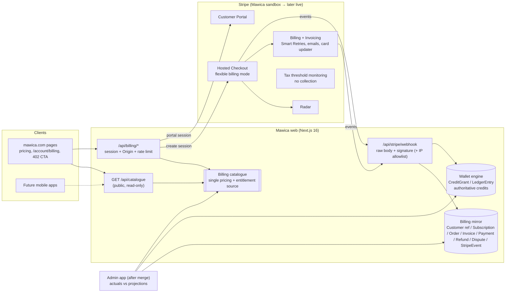
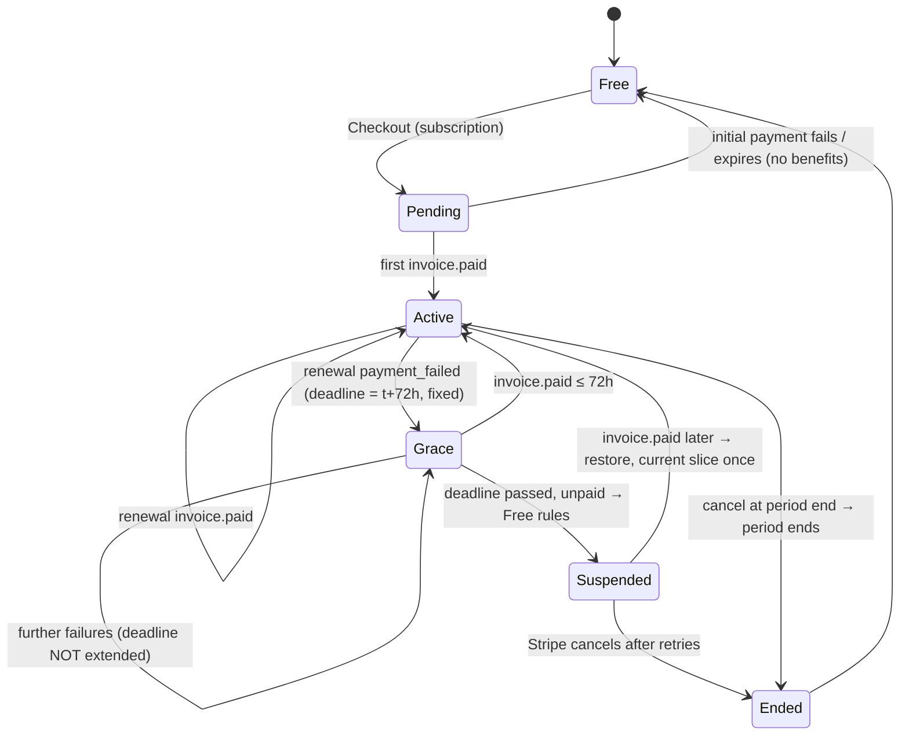

# Mawica: Stripe Phase 1B, decisions, verification and revised plan

| | |
|---|---|
| Date | 27 November 2026 (revision 2: Stripe verification and planner completed) |
| Builds on | `STRIPE-PHASE-1-AUDIT.md` (conditionally approved) |
| Repository state | `feature/hero-copy-readability` at `b52d9eb`; admin reviewed read-only on `feature/admin-deployment-r1` (not merged) |
| Scope | Audit and planning only. No application code, project dependencies, migrations, Stripe products, prices or settings, payments, branches, Azure resources or release gates were changed. Nothing committed. |
| Stripe environment | **Mawica sandbox** (test mode only) |
| **Phase 2 recommendation** | **CONDITIONAL GO for Phase 2 Foundations only**, once the owner approvals in §22 are given. No purchase is activated in Phase 2. |
| **Revision 3** | 27 Nov 2026: owner's final Phase 1B decisions recorded (§0). They supersede the statuses marked below where they differ. |

## 0. Revision 3: final approved business decisions (owner instruction, 27 Nov 2026)

All items below are **[APPROVED]** by the business owner.

| Area | Approved decision | Replaces |
|---|---|---|
| Card classification | Premium is an explicit card-level commercial decision. Animated, 3D and AR do not make a card premium. All six free launch cards and their AR stay free. Lumi's Wish stays premium. Every individually purchased premium card costs **AUD $2.99**. | D18 (now final) |
| Premium passes | Approved architecture (§11): `PREMIUM_PASS` within the append-only ledger. **Never expire.** No regular send credit needed. Survive cancellation and downgrade. **Card-specific passes are reserved for that card for 7 days, then become general.** Allowances first for ordinary premium sends. Explicit card-specific intent respected. Duplicate grants, concurrent redemption and double spending prevented. | D3 rules, Q18 (7 days) |
| Corporate | **Q1 approved:** 1,000 total sends/year with **up to 100 premium within** the 1,000. **Q2 approved:** annual subscribers get the annual allocation; monthly subscribers get 83 or 84 total (8 or 9 premium) per **successfully paid** month by the cumulative formula (exactly 1,000 and 100 over 12 paid months). The full year is never granted after one monthly payment. AUD $20/month, $120/year. **Not purchasable** until implemented and approved. | D2c, Q1, Q2 |
| Payment grace | **Q22 Option A approved.** Fixed 72 h from the first failed renewal payment; unused last-paid-period allowance usable during grace; no new allowance for unpaid periods; Unlimited keeps unlimited during grace; retries never extend the deadline; after 72 h unpaid, Free benefits; passes, cards, data and history preserved; paid entitlements restored after verified recovery; no duplicate grants. | D7 behaviour, D19, Q15, Q22 |
| Unlimited | Unlimited regular and premium; explicit unlimited entitlement; no large finite balance; no hidden commercial quotas; configurable technical abuse controls. **Thresholds and customer-facing terms still need approval before Unlimited becomes purchasable.** | D2d (Q6 remains open) |
| Stripe commercial settings | **Q20 Adaptive Pricing: disabled initially. Q21 Managed Payments: disabled initially.** AUD. 50% annual discount. Hosted Checkout. Customer Portal. Cancellation at the end of the paid period. No automatic tax collection until obligations are confirmed. Tax-threshold monitoring: **review and recommend** (recommendation in `STRIPE-PHASE-2-FOUNDATIONS-REPORT.md` §6). Future Apple / Google in-app payment requirements stay documented (§2.4 C5, §9.1). **No Stripe Dashboard changes without separate approval.** | D6 (cancellation), Q20, Q21 |

### 0.1 Remaining unresolved decisions after revision 3
| Q | Decision | Blocks |
|---|---|---|
| Q3 | Corporate seats, roles and multi-org membership | Phase 5 |
| Q4 | Corporate branding scope | Phase 5 |
| Q5 | Corporate members' personal Free wallet (proposed: kept separate) | Phase 5 |
| Q6 | Unlimited fair-use thresholds and customer-facing terms | Phase 4 activation |
| Q7 | Price display once GST-registered | Before live mode |
| Q8 | Refund wording and change-of-mind window | Phase 3 activation |
| Q9 | Trials / promotion codes | Phase 3 activation |
| Q10 | Corporate card vs invoice payment and terms | Phase 5 |
| Q11 | Account deletion with an active subscription | Phase 3 activation |
| Q12 | Statement descriptor and support contact (sandbox shows `WWW.MAWICA.COM`) | Live mode |
| Q13 | Admin branch merge timing | Phase 7 |
| Q17 | Event invitations vs wallet sends; Free users buying Events; package validity | Phase 6 |
| Q19 | Direct tier switching mid-annual term | Phase 3 design |
| Q23 | Delivery of scheduled cards beyond the Free horizon after suspension (proposed: deliver) | Phase 3 |
| D5 / D6 | Refund mechanics; upgrade-immediate / downgrade-at-renewal (cancellation at period end is now approved) | Phase 3 |
| C1 | Customer identity (classic Customer vs Accounts v2) | **Phase 2: decided before customer mapping.** Recommendation in the Phase 2 report §4 |
| Tax | Threshold monitoring configuration (recommendation pending approval) | Dashboard change, separate approval |

**Labelling used throughout**
- **[APPROVED]**: a business decision confirmed by the owner.
- **[PROPOSED-POLICY]**: a business policy awaiting final owner approval.
- **[PROPOSED-TECH]**: a technical solution proposed by this document, awaiting approval.
- **[PLANNER]**: a recommendation from Stripe's implementation planner.
- **[STRIPE-BP]**: from Stripe's best-practice guidance (the plugin's `stripe-best-practices` skill), not the planner.
- **[OPEN]**: an outstanding business question.

---

## 1. Stripe verification results

### 1.1 Stripe MCP
| Check | Result |
|---|---|
| Plugin loaded in this session | ✅ Yes (Stripe skills available) |
| MCP server `plugin:stripe:stripe` | ⚠️ **Needs authentication**. Status `needs_auth`; the owner has not completed `/mcp` sign-in. |
| Impact | **None for Phase 1B.** The planner skill's preferred path is the **Stripe CLI** (`stripe tools plan`); the MCP is only a fallback. Account verification was done through the CLI. MCP sign-in is optional for Phase 2. |

### 1.2 Stripe CLI
| Check | Result |
|---|---|
| CLI version | 1.55.15 |
| Authenticated | ✅ Yes (`stripe whoami`: authorized) |
| Account | ✅ **Mawica sandbox**, `acct_…dpf9` |
| Authorized accounts | **Only one**: `Mawica sandbox`, modes: `test` only. **No Mercor or Closetsu account is accessible to this CLI login.** |
| Mode | ✅ `test` (CLI banner: "Running in Mawica sandbox · sandbox") |
| Role | Administrator (the owner's login; email not recorded here) |
| Session expiry | ⚠️ The CLI login expires at **27 Nov 2026 03:59 UTC**, about an hour after verification. **Re-run `stripe login` before Phase 2.** |
| CLI plugin | The `tools` CLI plugin (v0.21.0, published by Stripe) was **auto-installed** by the Stripe CLI the first time `stripe tools` ran. It is needed by the planner. It is a CLI extension in the user's Stripe CLI config, **not** a project dependency; `package.json` is unchanged. |

### 1.3 MAWICA account and sandbox confirmation
Read-only `GET /v1/account` through the CLI (secrets never displayed):

| Field | Value |
|---|---|
| Account | `acct_…dpf9`, type `standard` |
| Business / Dashboard name | `Mawica sandbox` |
| Business URL | `www.mawica.com` |
| Statement descriptor | `WWW.MAWICA.COM` (already set; D13 can accept or change it) |
| Country / default currency | **AU / aud** ✅ |
| Charges / payouts enabled, details submitted | false / false / false. Expected for a sandbox; the live account's business profile (ABN, partnership, bank) is an owner action before live mode. |
| Existing products | **0** (none created) |
| Existing webhook endpoints | **0** |

**Conclusion:** ✅ The CLI is connected to the **dedicated MAWICA sandbox**, not Mercor or Closetsu, in **test mode**, AU/AUD, empty. This is a Stripe **Sandbox** (isolated environment), which Stripe recommends over the shared test mode for new integrations [STRIPE-BP]. Stripe also recommends **separate sandboxes for local development and CI** (§19).

---

## 2. Stripe implementation planner output

The planner ran via `stripe tools plan` against the Mawica sandbox with the full business context: AUD, AU partnership, digital goods only, $2.99 one-time, Plus/Corporate/Unlimited monthly and annual, $60 Event, hosted Checkout, Billing, Portal, Invoicing, Radar, 72-hour grace, no tax collection, no Connect, existing Next.js/Prisma app with an append-only ledger. The guide was **accepted** (`status: accepted`); the guide ID is kept in the session notes, not here. The planner creates no Stripe objects.

### 2.1 Decision-tree selections (made on Mawica's behalf, for owner review)
| Planner tree | Selected path | Planner recommendation |
|---|---|---|
| Boost conversion | Stripe only → web → **not** Managed Payments → no invoice → hosted | Hosted Checkout; enable **Link**, **dynamic payment methods**, **Adaptive Pricing** |
| Integration path (subscriptions) | Web → not no-code → no custom branding → redirect OK → not Managed Payments | **Stripe-hosted Checkout** (`checkout_type: hosted`); **flexible billing mode** as the default |
| Pricing model | No seats, no volume tiers | **Flat-rate** prices |
| Billing model | Free access without a card | **Freemium** (Free plan with no card; upgrade later) |
| Lifecycle management | Self-serve, no custom UI | **Customer Portal** (upgrades, downgrades, cancellation, payment-method updates); **cancel at period end** recommended; proration is a configuration detail |
| Revenue recovery | Automatic, no custom logic | **Smart Retries + automated failed-payment emails + automatic card updates**; what happens after retries fail is a Dashboard setting |
| Tax | No current obligation | **Free Stripe Tax threshold monitoring**: assign a product tax category and confirm the head office address; **no collection** |
| Invoicing: create | Manual, repeated structure | **Dashboard + invoice rendering templates** (Corporate) |
| Invoicing: customise | Branding | **Invoice branding** (logo, colour, footer) |
| Invoicing: collect | Customer enters payment details | **Hosted Invoice Page + invoice reminders** |
| Invoicing: reconcile | Custom in-house system | **Webhook-driven updates**: `invoice.paid`, `invoice.payment_failed`, `charge.refunded`, **`credit_note.created`** |
| Sales-led quotes | not selected | Quotes only if Corporate becomes sales-led |

### 2.2 Accepted blueprints
1. **Subscription billing with hosted Checkout:**
   - Product + recurring Price;
   - Checkout Session `mode=subscription`, `ui_mode=hosted`, redirect to the short-lived URL;
   - webhooks `checkout.session.completed` (provision and persist the subscription ID), `invoice.paid` (provision each period), `invoice.payment_failed` (notify, send to the Portal, apply the failed-payment policy);
   - verify all webhook signatures.
2. **Customer Portal, using Accounts v2:**
   - portal configuration with invoice history, payment-method update and cancellation (add plan switching between catalogue prices);
   - portal sessions created server-side after app authentication, with a **`customer_account`** (Accounts v2) and a return URL;
   - webhooks `customer.subscription.updated` / `.deleted`, `payment_method.attached` / `.detached`, and the thin event `v2.core.account[configuration.customer].updated`.

### 2.3 Supplementary Stripe best practice [STRIPE-BP]
- **API version** `2026-11-18.endive`, Node SDK **23.2.0**. Instantiate a `StripeClient`; never use the global API-key pattern.
- **Restricted API key (`rk_`)** with least privilege instead of `sk_`, and a separate RAK per service. Keys live in a secrets vault (Azure Key Vault), never in source or committed env files. Rotate when staff with access leave.
- **Never pass `payment_method_types`**; use dynamic payment methods (Dashboard / payment method configurations).
- **One Product per plan** (Plus, Corporate, Unlimited, Premium card, Event). Monthly and annual are Prices on the same Product.
- **Fulfil on both `checkout.session.completed` and `checkout.session.async_payment_succeeded`**, gated on `payment_status`.
- **Resolve webhook events through Stripe's object graph** (subscription → customer/account → our mapping), **not via metadata by default**; metadata only as a fallback.
- Subscribe to `charge.dispute.created`, `charge.refunded` and `radar.early_fraud_warning.created` in addition to the lifecycle events. Subscribe only to events Mawica acts on.
- Webhook **IP allowlisting** of Stripe's published IPs as defence in depth, on top of signature verification.
- Tag Checkout Sessions with `integration_identifier` (API ≥ 2026-03-25).
- Planner coverage limit: **Radar is outside the planner's coverage**. Radar guidance here comes from Stripe docs and best practice, not the planner.

### 2.4 Reconciliation: planner vs Phase 1 and 1B documents
| Topic | Phase 1 / 1B position | Planner / best practice | Result |
|---|---|---|---|
| Hosted Checkout for one-time and subscriptions | Yes | Yes | ✅ Agree |
| Customer Portal | Yes | Yes (Accounts v2) | ✅ Agree; ⚠️ customer object choice, see C1 |
| Webhook-only fulfilment, signature verification | Yes | Yes | ✅ Agree |
| Webhook events | Phase 1 §8 / 1B §16 | Adds `credit_note.created`, `payment_method.attached/detached`, `v2.core.account[configuration.customer].updated` | ➕ Added to §16 |
| Metadata cross-check in webhooks | Phase 1 proposed metadata cross-checks | Resolve by object graph; metadata only as fallback | 🔁 **Revised** (§8) |
| Flexible billing mode | Not specified | Default | ➕ Adopted |
| Revenue recovery | Custom retries inside 72 h | Smart Retries (Stripe ML timing) + emails + card updater | ⚠️ **C2**: resolved by a server-side 72 h deadline that is independent of Stripe's retry timing (§12) |
| Freemium | Free plan exists | Freemium | ✅ Agree |
| Tax | `automatic_tax` off | Off; enable **free threshold monitoring** (product tax category + head office address) | ➕ Owner Dashboard action, no collection |
| Restricted keys | Recommended | Required practice | ✅ Agree, now a Phase 2 requirement |
| Product per plan | Not explicit | Required | ➕ Adopted in the catalogue (§9) |
| Link / dynamic payment methods | Not specified | Enable | ➕ Adopted (Dashboard) |
| **Adaptive Pricing** | AUD only | Enable for conversion | ⚠️ **C3**: shows prices in local currency to overseas buyers (settles in AUD). Interacts with the owner's AUD-only and overseas-tax decisions. **[OPEN] Q20** |
| **Managed Payments** (Stripe as merchant of record for digital goods, handling tax and compliance) | Not considered | Offered as a path for digital-only sellers | ⚠️ **C4**: a material alternative for overseas digital-sales tax. Not selected; **[OPEN] Q21** |
| Radar | Default rules + custom rules + EFW handling | Outside planner coverage; best practice: handle EFW/dispute events | ✅ Consistent |
| Mobile apps (future) | Catalogue shared with mobile | Planner: digital goods sold **inside** mobile apps are subject to app-store rules (Apple guidelines link) | ⚠️ **C5**: future in-app selling may require app-store billing. Plan the catalogue to support it, but don't build it now |
| Corporate invoicing | `send_invoice` subscriptions + staff invoices | Dashboard + templates + branding + hosted invoice page | ✅ Agree; staff-created invoices in the Dashboard first, API later |

### 2.5 Architectural conflicts and additional risks
- **C1: Accounts v2 vs classic Customer.**
  - The planner's Portal blueprint uses Accounts v2 customer-configured accounts (`customer_account`). The Phase 1 design assumed `cus_` Customers.
  - **[PROPOSED-TECH]:** follow the planner and use Accounts v2 customer accounts for new customers, **provided** Phase 2 step 0 confirms (in the sandbox, read-only docs check) that Checkout subscription mode, one-time Checkout, Invoicing and the Portal all accept `customer_account` on API `2026-11-18.endive`.
  - The mapping table stores a generic `stripeCustomerRef` plus a `refType` (`ACCOUNT_V2` | `CUSTOMER`) so either works without a schema change.
- **C2: retry timing vs 72 h.** Stripe's Smart Retries choose retry times by ML and may continue beyond 72 h. Mawica's server-side `graceEndsAt` governs benefits. A payment that succeeds later still restores benefits (§12).
- **C3 / C4:** see Q20 and Q21.
- **C5:** future mobile in-app sales; see §9.4.
- **R-new-1:** the CLI auth expiry and the owner's login email being visible to tools. No email is recorded in documents; re-login before Phase 2.
- **R-new-2:** the CLI sandbox key is held by the Stripe CLI config/keychain on this Mac. Phase 2 code must use the owner-entered **restricted key** from `.env.local`, never the CLI's key.

---

## 3. Updated decision register

| # | Topic | Status | Decision / position |
|---|---|---|---|
| D1 | Individual premium card price | **[APPROVED]** | AUD **$2.99** flat for every premium card, whatever the technology. No $4.99/$6.99 tiers. |
| D2a | Free | **[APPROVED]** | 10 regular sends/month; one lifetime welcome premium card; $2.99 add-ons. |
| D2b | Plus | **[APPROVED]** | $10/month, $60/year; 50 total/month, ≤5 premium **within** the 50; $2.99 add-ons. |
| D2c | Corporate | **[APPROVED]** prices; entitlement **[PROPOSED-POLICY]** | $20/month, $120/year. Proposed: 1,000 total/year with ≤100 premium **within** it; annual = annual allocation; monthly = progressive allocation (§14). Not activated until built and tested. |
| D2d | Unlimited | **[APPROVED]** | $30/month, $180/year; unlimited regular and premium, fair use. Thresholds and terms need **separate approval** (§15). |
| D2e | Event | **[APPROVED]** | $60 one-time; ≤500 invitations; RSVP, guests, tables, reminders, digital tickets. Not activated until built and tested. Ticket sales and the 10% fee excluded. |
| D3 | Purchased premium includes its send | **[APPROVED]** | No extra regular credit; separate from subscriptions; survives cancellation and downgrade; purchase intent preserved. Rules in §11: **[PROPOSED-POLICY]**. |
| D4 | Tax display and collection | **[PROPOSED-POLICY]** | Display final prices inclusive of applicable taxes; no GST collection until obligated; overseas review before international launch. Planner adds: enable free threshold monitoring. |
| D5 | Refunds | **[PROPOSED-POLICY]** | ACL-compliant; mechanics in §11.5. |
| D6 | Upgrades / downgrades / cancellation | **[PROPOSED-POLICY]** | Upgrade immediate with proration; downgrade at renewal; cancel at period end (matches planner). |
| D7 | Failed-payment grace | **[APPROVED]** 72 h; behaviour **[PROPOSED-POLICY]** | §12. |
| D8 | Annual discount | **[APPROVED]** | 50% (annual = 6 × monthly). |
| D9 | Trials / promo codes | **[OPEN]** Q9 | Proposal: none at launch (planner: freemium, no trial). |
| D10 | Corporate payment method | **[OPEN]** Q10 | Planner: Dashboard invoices + hosted invoice page are fine to start. |
| D11 | Rollover | **[PROPOSED-POLICY]** | No rollover (except the Corporate within-year accrual, §14, and the 72 h grace carry-over, §12). |
| D12 | Account deletion with an active subscription | **[OPEN]** Q11 | |
| D13 | Statement descriptor | **[OPEN]** Q12 | Sandbox already shows `WWW.MAWICA.COM`. |
| D14 | Admin merge timing | **[OPEN]** Q13 | |
| D15 | Live business profile | **[OPEN]** owner action | |
| D16 | Currency | **[APPROVED]** | AUD (see Q20 Adaptive Pricing). |
| D17 | Architecture direction | **[APPROVED]** | Hosted Checkout, Billing, Portal, verified idempotent webhooks, Key Vault, test only, ledger authoritative, welcome gift preserved, existing UI preserved. |
| D18 | **Card classification** | **[APPROVED]** (owner direction, revision 2) | Premium is an explicit **commercial** classification per card, independent of technology. The six launch cards (including snow globe, tree, gift and their AR) **stay free**. Lumi's Wish cards **stay premium**. No new paywalls. §10. |
| D19 | Post-grace fallback | **[PROPOSED-POLICY]** (owner direction) | Free membership rules after 72 h unpaid. |
| D20 | Consumption order | **[APPROVED]** (owner direction) | Subscription allowances first for ordinary premium sends; earmarked purchases keep their intent (§11). |
| D21 | Accounts v2 customers | **[PROPOSED-TECH]** | C1. |
| D22 | Stripe environment | **[APPROVED]** (verified) | Mawica sandbox, test mode. Separate dev and CI sandboxes recommended. |

## 4. Remaining business decisions
| Q | Question |
|---|---|
| Q1 | Confirm Corporate premium is **within** the 1,000 (proposed) rather than additional. |
| Q2 | Approve the Corporate progressive allocation (§14) and its within-year accrual. |
| Q3 | Corporate seats: limit per organisation? Roles? Multi-org membership? |
| Q4 | Corporate branding scope: logo, sender name, colours, custom domain? |
| Q5 | Do Corporate members keep their personal Free allowance separately? (Proposed: yes; personal and organisation wallets are separate.) |
| Q6 | Unlimited fair-use thresholds and customer-facing terms (§15). |
| Q7 | Price display once GST-registered (absorb vs raise). |
| Q8 | Refund wording and change-of-mind window for unused passes. |
| Q9 | Trials / promotion codes. |
| Q10 | Corporate card vs invoice payment and terms. |
| Q11 | Account deletion with an active subscription. |
| Q12 | Statement descriptor and support contact. |
| Q13 | Admin branch merge timing. |
| Q15 | Approve the Free fallback after grace (D19). |
| Q17 | Event: do invitations consume wallet sends? Can Free users buy Events? Validity of an event package? |
| Q18 | Earmark hold period for a pass bought for a specific card (proposed 7 days, §11.3). |
| Q19 | Direct tier switching mid-annual term. |
| Q20 | **Adaptive Pricing** (planner): show local-currency prices to overseas buyers? (Proposed: **off** until the overseas tax review.) |
| Q21 | **Managed Payments** (planner): evaluate Stripe as merchant of record for digital goods to cover overseas tax? (Proposed: evaluate before international launch; not for Phase 2.) |
| Q22 | Grace carry-over option A vs B (§12.3). |
| Q23 | Scheduled cards beyond Free's 1-month horizon after suspension: deliver (proposed) or hold? |

(Q14 and Q16 from revision 1 are now resolved by D18 and D20.)

---

## 5. Pricing and entitlement matrix

Values **[APPROVED]** unless marked; mechanics **[PROPOSED-TECH]**.

| Plan | AUD | Billing | Total sends | Premium | Welcome | Add-on | Allocation | Activation |
|---|---|---|---|---|---|---|---|---|
| Free | $0 | none | 10/month | 0 (welcome + add-ons only) | 1 lifetime | $2.99 | Account anniversary (unchanged) | live today |
| Plus monthly | $10 | monthly | 50/month | ≤5 within 50 | kept if unused | $2.99 | Slice from billing anchor, paid periods only | Phase 3 |
| Plus annual | $60 | yearly | 50/month × 12 | ≤5 within each 50 | kept | $2.99 | 12 lazy monthly slices | Phase 3 |
| Corporate monthly | $20 | monthly | 1,000/yr progressive | ≤100/yr within (**proposed**) | n/a | $2.99 | Cumulative-floor allocation (§14) | Phase 5 only |
| Corporate annual | $120 | yearly | 1,000/yr | ≤100/yr within (**proposed**) | n/a | $2.99 | One annual allocation | Phase 5 only |
| Unlimited monthly | $30 | monthly | Unlimited | Unlimited | kept | not needed | Entitlement flag | Phase 4 |
| Unlimited annual | $180 | yearly | Unlimited | Unlimited | kept | not needed | Entitlement flag | Phase 4 |
| Event | $60 | one-time | n/a (Q17) | n/a | n/a | n/a | EventPass (500) | Phase 6 only |
| Premium card | $2.99 | one-time | not required | 1 self-contained | n/a | n/a | `PREMIUM_PASS` grant | Phase 3 |

---

## 6. Confirmed business decisions (summary)
**[APPROVED]**:
- **Pricing:** AUD; Free 10/month + welcome; Plus $10/$60 with 50/month and ≤5 premium within; Corporate $20/$120; Unlimited $30/$180 unlimited with fair use; Event $60; premium card $2.99 flat for every technology; 50% annual discount.
- **Purchased cards:** include their send without a regular credit; are separate from allowances; survive cancellation and downgrade; allowance first for ordinary sends; purchase intent preserved.
- **Grace:** 72-hour grace.
- **Cards:** card classification is commercial and independent of technology; launch cards stay free; Lumi's Wish stays premium.
- **Architecture:** hosted Checkout, Billing, Portal; verified idempotent webhooks; ledger authoritative; welcome gift preserved; Key Vault; test only.
- **Activation:** Corporate and Event not activated until built and tested.
- **Environment:** the verified Mawica sandbox.

## 7. Proposed policies requiring final approval
**[PROPOSED-POLICY]**:
- upgrades immediate with proration; downgrades at renewal; cancellation at period end;
- no rollover (with the two scoped exceptions);
- ACL refund mechanics (§11.5);
- tax-inclusive display; no GST collection until obligated; overseas tax review;
- grace behaviour and recovery (§12); Free fallback;
- pass redemption, expiry, earmark, resend and refund rules (§11);
- Corporate entitlement and allocation (§14);
- Unlimited abuse-prevention controls (§15; thresholds separate);
- Adaptive Pricing off and Managed Payments deferred (Q20, Q21).

---

## 8. Revised payment architecture [PROPOSED-TECH]



- **Stripe is the authoritative external payment and subscription record.** Mawica keeps verified internal entitlement and transaction records: the ledger plus the billing mirror. **No parallel wallet.**
- **Hosted Checkout only.** No `@stripe/stripe-js`. `NEXT_PUBLIC_STRIPE_PUBLISHABLE_KEY` stays unset unless a client-side integration is introduced later. The only Phase 2 dependency is server-side `stripe` (Node SDK 23.2.0, API `2026-11-18.endive`).
- **Server-controlled prices:**
  - product code (Zod enum) → catalogue → `lookup_key` → Stripe Price;
  - amount, currency and interval are verified against the catalogue, and the call fails closed on mismatch;
  - no `payment_method_types`; `integration_identifier` is set.
- **Customer mapping:**
  - one Stripe customer per Mawica user, and per organisation for Corporate;
  - Accounts v2 customer accounts preferred (C1);
  - created lazily on first checkout;
  - events resolved via the object graph (subscription → customer/account → our row); metadata is only a fallback.
- **Order and payment state:** `BillingOrder` (one-time) and `BillingSubscription` (recurring) mirrors with conditional state transitions. `BillingPayment` holds amount/fee/net from balance transactions.
- **Refunds and disputes:** handled from webhooks; clawback only of unspent purchased or allowance credits (§11.5).
- **Corporate invoicing:** Dashboard-created invoices with a rendering template and branding, hosted invoice page and reminders (planner); `send_invoice` subscriptions when Q10 is decided.
- **Radar:** default rules; block on CVC/postcode failure; review elevated risk; early-fraud-warning auto-refund and revoke; throttle Mawica's checkout endpoint against card testing.
- **Tax:** no collection; owner enables free threshold monitoring in the Dashboard (product tax category + head office address).

---

## 9. Shared pricing and entitlement architecture [PROPOSED-TECH]

### 9.1 One authoritative configuration
`src/modules/billing/catalogue.ts`, a versioned, reviewed, **pure data** module. It contains no secrets and no Stripe IDs, so it is safe to share with clients. Each entry:

```ts
type CatalogueEntry = {
  code: "plus_month" | "plus_year" | "corporate_month" | "corporate_year"
      | "unlimited_month" | "unlimited_year" | "premium_card" | "event";
  product: "plus" | "corporate" | "unlimited" | "premium_card" | "event"; // one Stripe Product each [STRIPE-BP]
  kind: "subscription" | "one_time";
  interval?: "month" | "year";
  amountCents: number;          // 1000, 6000, 2000, 12000, 3000, 18000, 299, 6000
  currency: "aud";
  lookupKey: string;            // e.g. "mawica_plus_month_aud_v1"
  planKey?: "plus" | "corporate" | "unlimited";
  purchasable: boolean;         // corporate_* and event = false until their phases pass
  display: { name: string; badge?: string; compareRank: number };
};
```

- **Entitlements** stay in `Plan` / `PlanEntitlement` (database rows, already "plans are data"), seeded by migration. A unit test asserts that catalogue plan keys and entitlement rows match the approved matrix (§5).
- **Consumers:**

| Consumer | How it uses the catalogue |
|---|---|
| Public website and membership comparison page | Server components import the catalogue directly (prices formatted `A$10`, "incl. applicable taxes") |
| Checkout | `POST /api/billing/checkout` accepts only `code`s with `purchasable: true` |
| Backend entitlement services | Read `Plan` / `PlanEntitlement`; a test enforces agreement with the catalogue |
| Stripe product and price mappings | A sync script (manual, sandbox first) creates or verifies Products and Prices **by `lookup_key`**, fails on any amount drift, and never edits prices in place (new version + `transfer_lookup_key`) |
| Admin finance projections | Import list prices from the catalogue; keep only volume, churn and opex assumptions editable; label as projections |
| Future mobile apps | `GET /api/catalogue` (public, cacheable JSON of codes, display names, prices, entitlements). See C5: in-app digital purchases may need app-store billing, so the catalogue reserves optional `appStoreProductId` fields later |

### 9.2 Placeholder prices that conflict with approved pricing
| Location | Item | Placeholder | Approved |
|---|---|---|---|
| `admin/src/modules/staff/finance/defaults.ts:24` (branch `feature/admin-deployment-r1`) | Plus monthly | 9.99 | **10.00** |
| `…defaults.ts:25` | Plus annual | 99.00 | **60.00** |
| `…defaults.ts:26` | Event booking | 249.00 | **60.00** |
| `…defaults.ts:27` | Corporate monthly | 199.00 | **20.00** |
| `…defaults.ts:28` | Corporate annual | 1,990.00 | **120.00** |
| `…defaults.ts:29` | Unlimited monthly | 29.99 | **30.00** |
| `…defaults.ts:30` | Unlimited annual | 299.00 | **180.00** |
| `…defaults.ts` (missing) | Premium card add-on | none | **2.99** |
| `…defaults.ts:4,11` | Tax basis | "exclusive of GST" | final consumer price, tax-inclusive display (D4) |
| `…defaults.ts` opex | Processing rate | 2.9% flat | actuals must use real Stripe fees |
| `prisma/migrations/20261110133003_card_wallet/migration.sql:212-224` (HEAD) | Plan rows | free, plus only, `purchasable=false` | no price conflict; Corporate and Unlimited rows are missing (to add) |
| HEAD marketing (`src/content/*`) | Prices | none ("Free to create") | no conflict; a pricing page is new work |

These are searched across HEAD and the newest admin branch. No other price literals were found. **Admin branches are not modified.**

---

## 10. Revised card classification policy

**[APPROVED] direction / [PROPOSED-TECH] mechanism**
1. **Premium is a commercial classification per card template**, declared explicitly in the server-side template registry (`templateTier()`). It is never derived from rendering technology.
2. **Technology is a separate descriptive attribute**, for example `technologies: ["animated" | "3d" | "ar"]`, used only for display and filtering. It never affects price or entitlement.
3. Both free and premium cards can be standard, animated, interactive 3D or AR.
4. **Preserved exactly:** the six launch cards (including the Christmas snow globe, Christmas tree, gift and their AR experiences, plus the New Year cards) stay **STANDARD / free**. `lumis-wish` and `lumis-wish-cinema` stay **PREMIUM**. Card availability is unchanged and no existing free card gets a paywall.
5. **Every premium card costs the same $2.99** when bought individually, and uses the same `PREMIUM` allowance unit within plans. There are no sub-tiers.
6. **Snapshot rule (existing):** `Card.tier` is recorded at publish, so reclassifying a template never rewrites history or re-charges.
7. **Guardrails:**
   - a "golden" unit test pins the tiers of the six launch cards and the two Lumi's Wish cards;
   - changing any template's tier requires owner approval and applies only to **new** publishes;
   - AR viewing, link sharing and QR codes never consume entitlements, whatever the tier.

---

## 11. Premium pass architecture

### 11.1 Ledger representation [PROPOSED-TECH]
- **New `GrantUnit` value `PREMIUM_PASS`** in the existing append-only ledger. It is a self-contained premium send and **does not require a TOTAL credit**.
- Created only by `grantCredit(source: PURCHASE, unit: PREMIUM_PASS, grantKey: "purchase:<orderId>:<n>", validTo: NULL)`. One paid order with quantity *q* gives exactly *q* passes (default 1).
- **Distinguishable from subscription allowances:** different unit, different source and different grantKey prefix. Reported separately (`passes` in `/api/wallet`).
- **Survives** cancellation, downgrade, grace suspension and plan changes, because `assignPlan` only expires `PLAN_PERIOD` / `SUBSCRIPTION_PERIOD` grants.

### 11.2 Duplicate and concurrency protection
| Threat | Protection |
|---|---|
| Duplicate webhook | `StripeEvent` PK insert-first; `BillingOrder` conditional `PENDING→PAID`; grantKey unique per account |
| Double click / retried checkout | Client Idempotency-Key + Stripe idempotency key on Checkout Session creation; one open PENDING premium order per draft |
| Concurrent redemption | Pass rows locked `FOR UPDATE` and decremented conditionally (`remaining > 0`, CHECK constraint); 50-way concurrency test |
| Same pass used twice | `CreditReservation` idempotency + immutable reservation trigger; committed reservations can never be released |

### 11.3 Purchase intent (earmarking) [PROPOSED-POLICY + TECH]
- When a customer hits a 402 and buys a pass **for a specific card draft**, the order records `intentRef` (a hash of the draft's idempotency key and template key) and `intentExpiresAt` (proposed **7 days**, Q18).
- The publish request that carries that draft's idempotency key redeems **that order's pass first**, even if an allowance has since become available. This preserves the purchase intent.
- **Ordinary premium sends never consume an earmarked pass while the earmark is active.** After `intentExpiresAt` (or if the draft is discarded), the pass becomes a general pass. **It is never lost.**
- Passes bought from `/account/wallet` without a draft are general passes.

### 11.4 Redemption order for a premium send [PROPOSED-TECH, implements D20]
Inside one transaction, locking in a fixed order (TOTAL → PREMIUM → PREMIUM_PASS):
1. Publish carries an **earmark** → spend that pass (`entitlement = PASS`).
2. **Unlimited** plan in ACTIVE or GRACE → `UNLIMITED` reservation (no decrement) after abuse checks.
3. **Allowance:** 1 TOTAL + 1 PREMIUM (plan slice, Corporate allocation or welcome) → `ALLOWANCE`. This is the existing rule and keeps welcome-gift behaviour unchanged.
4. **General pass** → spend 1 `PREMIUM_PASS` only, with **no TOTAL needed** (`PASS`).
5. Otherwise → 402 with the "A$2.99" call to action.

Standard sends never use passes. The welcome gift still needs one TOTAL, as it does today.

### 11.5 Redemption, expiry, resend and refund rules [PROPOSED-POLICY]
| Rule | Proposal |
|---|---|
| Redemption | 1 pass = 1 premium card publish (immediate or scheduled), any premium template, any technology |
| Scheduled then cancelled | Pass released back (it has no expiry, so it is always restorable) |
| Expiry | **None** while the account exists (`validTo = NULL`). If an expiry is ever wanted: ≥3 years, after legal check |
| Resend / share | Copying the link, regenerating the QR code, recipients reopening and AR viewing are **free and unlimited** (current behaviour). A *new* card to another recipient is a new send |
| Edit after publish | Not offered today; if added, editing the same card never consumes a second pass |
| Refund of an unused pass | Full refund on request within the change-of-mind window (Q8); webhook claws back the pass (`ADJUST −1`, `reason refund:<re_id>`) |
| Refund of a used pass (ACL remedy) | Money refunded; card stays live; no negative balance; shortfall audited |
| Dispute | Unspent pass frozen on `charge.dispute.created`; clawed back if lost, restored if won |
| Account deletion | Unused passes forfeited only under the Q11 policy; ledger kept anonymised |

---

## 12. Three-day failed-payment grace lifecycle

### 12.1 Principles [PROPOSED-POLICY + TECH]
- **Authoritative server-side deadline:** `graceEndsAt = time of the first failed renewal payment for invoice X + 72 h`, stored on `BillingSubscription`.
- **Not extended** by later retries or repeated `invoice.payment_failed` events for the same invoice. It is set once with `COALESCE`, guarded by `invoice id`.
- **Independent of Stripe's retry timing** (C2). Stripe Smart Retries, failed-payment emails and the card updater stay on (planner). Mawica's benefits follow `graceEndsAt`. Stripe may keep retrying after 72 h, and a later success still recovers.
- **Initial payment failure is never a subscription:** statuses `incomplete` / `incomplete_expired`, or a `subscription_create` invoice that is unpaid, give **no** paid benefits.
- **Stripe after-retries setting** (owner, Dashboard): proposed "mark subscription **unpaid**" (keeps it recoverable via the Portal and hosted invoice page), then cancel after the Smart Retries window. Mawica treats `unpaid` as SUSPENDED and `canceled` as ENDED.

### 12.2 Exact state transitions (`BillingSubscription.entitlementState`)
| From | Trigger | Guard | To | Effects (one DB transaction) |
|---|---|---|---|---|
| none | `checkout.session.completed` (subscription) | none | PENDING | Link customer/subscription; no grants |
| PENDING | `invoice.paid` (`subscription_create`) | invoice belongs to the subscription | ACTIVE | `assignPlan(plan)`; `billingAnchor`; `paidThrough`; current slice grant |
| PENDING | `incomplete_expired` / session expired / create invoice failed | none | ENDED | Nothing granted |
| ACTIVE | `invoice.paid` (`subscription_cycle`) | `period_end > paidThrough` | ACTIVE | `paidThrough` advances; new slices created lazily |
| ACTIVE | `invoice.payment_failed` (`subscription_cycle`) | first failure for that invoice | **GRACE** | `graceEndsAt = now + 72h`, `graceInvoiceId = X`; banner + Portal link; Stripe email |
| GRACE | another `invoice.payment_failed` for X | none | GRACE | **No change** (no extension) |
| GRACE | `invoice.paid` for X | before or after `graceEndsAt` | ACTIVE | `paidThrough` advances; grant the **current** slice only (idempotent key); clear grace fields; audit `billing.recovered` |
| GRACE | clock passes `graceEndsAt` (lazy check on every entitlement read + reconcile job) | X still unpaid | **SUSPENDED** | `assignPlan('free')` (paid slice grants expire with EXPIRE entries); audit `billing.suspended` |
| SUSPENDED | `invoice.paid` for X (Portal / hosted invoice / Smart Retry) | none | ACTIVE | `assignPlan(paid plan)`; grant the current slice of the now-paid period; no back-fill of fully elapsed slices |
| SUSPENDED | `customer.subscription.updated` → `unpaid` | none | SUSPENDED | Mirror only |
| any | `customer.subscription.deleted` | none | ENDED | `assignPlan('free')` if not already; passes and history kept |
| ACTIVE | `cancel_at_period_end = true` | none | ACTIVE (+ `cancelAtPeriodEnd`) | Access to `currentPeriodEnd` |

### 12.3 Allowance behaviour during grace (for approval)
| Plan | During 72 h grace | After 72 h (SUSPENDED) | On recovery |
|---|---|---|---|
| Plus / Corporate | Plan features remain (12-month scheduling horizon, plan badge). **No new allowance for the unpaid period.** **Option A (recommended):** unused credits from the *last paid* slice stay usable until `graceEndsAt` (grace carry-over, one audited `validTo` extension of those grants only). **Option B:** no allowance during grace; only passes and welcome (Q22) | Free rules: 10 regular/month on the Free anniversary; paid slice grants expired; passes and welcome kept | Paid plan restored; current slice granted once; `paidThrough` reconciled |
| Unlimited | **Unlimited benefits continue** (abuse controls still apply) | Free rules | Unlimited restored |
| All | Account, cards, scheduled cards, billing settings and the Portal stay accessible; **purchased passes untouched**; nothing deleted | Same; scheduled cards beyond the Free horizon: deliver (proposed, Q23) | Reconcile job confirms no duplicate grants |

**Duplicate prevention:** slice grants are keyed `sub:<subId>:<sliceStart>:<unit>`, so recovery after suspension, a replayed `invoice.paid` or a reconcile replay cannot grant the same slice twice. No slice is ever created for a period beyond `paidThrough`.



---

## 13. Revised database requirements [PROPOSED-TECH]
All additive. No changes to the Better Auth tables, `WelcomeGrantTombstone`, the ledger triggers or historical rows.

| Area | Change |
|---|---|
| `GrantUnit` | + `PREMIUM_PASS` |
| `GrantSource` | + `SUBSCRIPTION_PERIOD`, + `ORG_ALLOCATION` (Corporate) |
| `CreditReservation` | + `entitlement` enum `ALLOWANCE \| PASS \| UNLIMITED \| EVENT` (default `ALLOWANCE`, added to the immutable-identity trigger); + `actorUserId` (who sent on behalf of an org) |
| `CreditAccount` | + `organisationId` (nullable, unique); CHECK that exactly one owner is set for new rows |
| `Plan` / `PlanEntitlement` | + rows `corporate`, `unlimited`; keys `sends.unlimited`, `premium.unlimited`, `fair_use.profile`; `purchasable=false` until each phase |
| Engine | `loadEntitlements` returns `unlimited` instead of throwing; slices from `billingAnchor`; Corporate cumulative allocator |
| `BillingCustomer` | `userId?` / `organisationId?`, **`stripeCustomerRef` + `refType` (`ACCOUNT_V2` \| `CUSTOMER`)**, `livemode` |
| `BillingSubscription` | Stripe ID, price, `planKey`, interval, Stripe status, `entitlementState`, `billingAnchor`, `currentPeriodStart/End`, `paidThrough`, `graceEndsAt`, `graceInvoiceId`, `cancelAtPeriodEnd`, `pendingPlanKey` / `pendingEffectiveAt`, `lastEventCreated`, `livemode` |
| `BillingOrder` | kind `PREMIUM_PASS \| EVENT_PASS`, code, quantity (1–10), amount, currency `aud`, status, Checkout Session / PaymentIntent IDs (unique), **`intentRef`, `intentExpiresAt`**, `fulfilledAt`, `livemode` |
| `BillingInvoice`, `BillingPayment` (amount/fee/net/refunded/disputed), `BillingRefund`, `BillingDispute`, `StripeEvent` | As in revision 1 |
| Organisation (Phase 5) | `Organisation`, `OrganisationMember` (OWNER / BILLING_ADMIN / ADMIN / SENDER), `OrganisationInvite`, `OrganisationBranding` |
| Event (Phase 6) | `Event`, `EventPass` (limit 500), `EventGuest`, `EventRsvp`, `EventTable` / `EventSeat`, `EventReminder`, `EventTicket` (signed QR, not a paid ticket) |

---

## 14. Corporate entitlement proposal [PROPOSED-POLICY, not final]

### 14.1 Entitlement
- **1,000 total sends per subscription year**, including **up to 100 premium**. Premium is **within** the total, not additional: a premium send consumes 1 TOTAL + 1 PREMIUM, exactly as for Plus. **Q1 must confirm this.**
- Prices $20/month and $120/year **[APPROVED]**. **Not purchasable** until Phase 5 is built and tested.

### 14.2 Allocation
- **Annual subscribers:** on the paid annual invoice, one allocation of 1,000 TOTAL and 100 PREMIUM, valid for the subscription year (`ORG_ALLOCATION`, key `org:<subId>:<yearStart>:<unit>`). Unused allocation expires at the year end.
- **Monthly subscribers: cumulative-floor allocation.** For the *k*-th paid month (*k* = 1…12) of the current subscription year:

  `total_k = ⌊1000·k / 12⌋ − ⌊1000·(k−1) / 12⌋`    `premium_k = ⌊100·k / 12⌋ − ⌊100·(k−1) / 12⌋`

  - By construction, Σ total_k = ⌊1000·12/12⌋ = **1,000 exactly** and Σ premium_k = **100 exactly**. Integer arithmetic only, with no rounding drift.
  - Sequence: total 83, 83, 84, 83, 83, 84, 83, 83, 84, 83, 83, 84; premium 8, 8, 9, 8, 8, 9, 8, 8, 9, 8, 8, 9.
  - Premium never exceeds total in any month or cumulatively.
  - **Granted only on `invoice.paid` for that month** (key `org:<subId>:<yearStart>:m<k>:<unit>`). One payment never unlocks the year.
  - **Accrual within the year (proposed):** monthly allocations stay valid until the end of the subscription year, so an organisation that paid *k* months has up to ⌊1000k/12⌋ available minus what it used. Nothing carries into the next year. *Alternative:* expire each month's allocation at month end, like Plus (Q2).
  - **Monthly → annual switch mid-year:** the annual allocation = 1,000 − already allocated this subscription year (and likewise for premium), so the total never exceeds 1,000 per year.
  - **Annual → monthly at renewal:** the new year starts at *k* = 1.

### 14.3 Organisation ownership, team access, branding, cancellation (requirements)
| Area | Requirement |
|---|---|
| Ownership | The subscription, Stripe customer and wallet belong to the **organisation**, not a person. Exactly one OWNER at all times; ownership transfer required before the owner leaves or deletes their account |
| Roles | OWNER (everything), BILLING_ADMIN (Portal, invoices), ADMIN (members, branding), SENDER (send from the org wallet). Only OWNER and BILLING_ADMIN can open the Portal |
| Team access | Email invites to verified accounts; seat limit per Q3; members' personal Free wallets remain separate (Q5); every org send records `actorUserId` |
| Authorisation | Every org route checks membership + role server-side; no org ID trusted from the client without a membership check |
| Branding | Scope per Q4 (logo, sender display name, colours). Logo uses the existing private media pipeline. Branding never changes a card's commercial tier |
| Cancellation | Cancel at period end. After the end: sending stops; existing cards stay live; members keep personal accounts; the org wallet is preserved read-only; history kept |
| Grace | As §12; organisation owner and billing admins notified |
| Invoicing | Card via Checkout or `send_invoice` (Q10); ABN and billing details on invoices; rendering template + branding (planner) |

---

## 15. Unlimited fair-use proposal [PROPOSED-TECH; thresholds and terms need separate approval]
- **Explicit unlimited entitlement:** plan flags `sends.unlimited`, `premium.unlimited`. Sends create `UNLIMITED` reservations (with idempotency and audit) and **no fake balance**. The wallet UI shows "Unlimited".
- **No hidden commercial quotas:** there is no daily or monthly card cap. All controls below are **technical** and **configurable**, with values in configuration (not code) pending approval.

| Control | Mechanism | Action |
|---|---|---|
| Request rate limiting | Existing Postgres limiter per user and IP on publish, schedule, media upload and checkout; burst windows (per minute / per hour) applied to **all plans** | 429 with retry-after; no plan downgrade |
| Automated spam detection | Similarity of message text across sends, link-only messages, recipient-name patterns, report rate (existing Report flow) | Review flag; optional step-up (re-verify email) |
| Suspicious account activity | Many sessions or networks per account, rapid recipient churn, new-account bursts, scripted request timing | Review flag + audit `fairuse.flag` |
| Review flags | Admin queue (Phase 7) with context; staff actions (warn, temporary throttle, suspend) are **manual**, role-gated (`fairuse:act`) and audited | |
| Bulk-sending / resource abuse | Concurrency caps on in-flight publishes per account; media size and processing limits (existing); scheduled-queue depth alert; worker back-pressure | Throttle or queue, never silently drop |

Customer-facing fair-use terms and every threshold value require **separate owner approval (Q6)** before Unlimited is activated (Phase 4).

---

## 16. Revised API endpoint requirements [PROPOSED-TECH]
| Method & path | Auth | Purpose |
|---|---|---|
| `GET /api/catalogue` | public, cacheable | Purchasable products, display prices, entitlements (no Stripe IDs) for web and mobile |
| `GET /api/billing` | session | Plan, entitlementState, paidThrough, graceEndsAt, cancel/pending change, passes (general / earmarked) |
| `POST /api/billing/checkout` | session + verified email + Origin + JSON + Idempotency-Key + rate limit | `{ code, draft?: { idempotencyKey, templateKey } }`; only `purchasable` codes; refuses a second active subscription; returns `{ url }` |
| `POST /api/billing/portal` | session (+ org role for Corporate) + Origin + rate limit | Portal session for the caller's own customer or account |
| `POST /api/stripe/webhook` | Stripe signature on the raw body (`await request.text()`), optional IP allowlist | Verified, deduplicated, transactional; no session, Origin or rate limit |
| `GET /api/wallet` (existing) | session | + `passes`, `unlimited`, `entitlementState` |
| `POST /api/cards` (existing) | unchanged | 402 body + `purchase: { code: "premium_card", price: "A$2.99" }`; redeems an earmarked pass when the draft key matches |
| Corporate (Phase 5) | session + org role | `/api/orgs/*` members, invites, branding |
| Admin (after merge) | Entra + RBAC | actuals, refunds, adjustments, corporate invoices, reconciliation, fair-use queue |

## 17. Webhook event mapping (revised with planner additions)
| Event | Action | Idempotency |
|---|---|---|
| `checkout.session.completed` | `payment` + `paid` → fulfil the order (pass / event pass). `subscription` → link only | StripeEvent PK; order conditional; grantKey |
| `checkout.session.async_payment_succeeded` / `_failed` | Fulfil / FAILED | same |
| `checkout.session.expired` | Order → EXPIRED; earmark released | conditional |
| `customer.subscription.created` / `.updated` | Mirror status, price → plan, anchor, period, cancel flag, pending change; `unpaid` → SUSPENDED | `lastEventCreated` + re-fetch |
| `customer.subscription.deleted` | ENDED → Free | same |
| `invoice.paid` | Activate / renew / recover; slice or org allocation; BillingInvoice + BillingPayment | invoice ID; slice keys |
| `invoice.payment_failed` | Renewal → GRACE (deadline set once); create → nothing | invoice ID + state guard |
| `invoice.finalized` / `.voided` / `.marked_uncollectible` / `.overdue` | Mirror (Corporate) | invoice ID |
| `credit_note.created` **(planner)** | Mirror; adjust actuals; clawback if credit relates to unspent purchases | `cn_` ID |
| `charge.refunded` / `refund.created` / `refund.updated` | BillingRefund; clawback of unspent credits | `re_` ID |
| `charge.dispute.created` / `.updated` / `.closed` | BillingDispute; freeze / claw back / restore | `dp_` ID |
| `radar.early_fraud_warning.created` | Flag; auto-refund per policy; revoke | `issfr_` ID |
| `payment_method.attached` / `.detached` **(planner)** | Only if Mawica displays payment-method state (proposed: not stored → not subscribed) | n/a |
| `v2.core.account[configuration.customer].updated` **(planner, thin)** | Only if customer data is mirrored locally (proposed: minimal; subscribe only if C1 = Accounts v2 and data is stored) | event ID |
| time-based | GRACE → SUSPENDED at `graceEndsAt`; earmark expiry | reconcile job |

## 18. Wallet and entitlement reconciliation strategy
1. Per grant: `remaining = SUM(ledger delta)` (existing `reconcile()`).
2. Every PAID order has exactly `quantity` `PREMIUM_PASS` grants, minus clawbacks. Earmarks are consistent with order intent.
3. Every ACTIVE subscription has its current slice or org allocation. **No grant exists beyond `paidThrough`.** Corporate monthly allocations to date equal ⌊1000k/12⌋ and ⌊100k/12⌋.
4. GRACE rows past their deadline are SUSPENDED. `CreditAccount.planKey` agrees with `entitlementState`.
5. Nightly, Stripe → DB: paid invoices, succeeded charges, refunds, disputes and credit notes in the window have matching rows. FAILED or stale events are replayed.
6. **Drift is reported (admin + audit) and never auto-fixed** except by idempotent replays of recorded events.

---

## 19. Admin integration requirements (no admin changes in this phase)
- **Branches audited read-only:** `admin-p0-p1 → p2-customers → p3-ops-analytics → p4a-financial-planning → p5-cms-foundation → p5c-marketing-media → p5d-visual-editor → admin-deployment-r1`, plus `fix/roles-sql-azure-admin`. None is merged.
- **Dependencies:**
  - Payment phases 2–4 **do not depend** on admin; refunds can be done in the Stripe Dashboard and webhooks keep the ledger consistent.
  - Real finance reporting (Phase 7) depends on the admin merge (Q13) and the billing tables.
  - Admin needs the shared catalogue (§9).
  - Admin's 4 migrations (`staff_admin`, `cms_*`) must be ordered with the Phase 2 billing migrations. **Plan one merge order to avoid migration conflicts.**
- **Placeholder prices:** §9.2 (all seven conflict, the premium card line is missing, and the tax basis conflicts).
- **Projected vs actual:** keep the projection page as is (catalogue prices). Add a separate `/finance/actuals` built only from billing tables. They are never mixed.
- **Reporting:**
  - gross revenue; Stripe fees; refunds; disputes (amount + fees); taxes (0 until registered); net;
  - MRR/ARR (annual ÷ 12, matching the existing `forecast.ts` recognition);
  - active subscriptions by plan and interval; churn; grace and suspension counts; recoveries;
  - pass sales, redemptions and unused-pass liability.
- **Permissions [PROPOSED-TECH]:**
  - `billing:read` (OWNER, FINANCE; SUPPORT limited);
  - `billing:refund` (OWNER, FINANCE; above a threshold OWNER only);
  - `billing:invoice` (OWNER, FINANCE);
  - `wallet:adjust` (OWNER, FINANCE; reason required);
  - `fairuse:act` (OWNER, SUPPORT).
- **Audit logging:**
  - `billing.checkout_created`, `billing.state_changed`, `billing.grace_started`, `billing.suspended`, `billing.recovered`;
  - `billing.refund_issued`, `billing.dispute_*`, `billing.corporate_invoice_created`;
  - `wallet.adjusted`, `fairuse.flag` / `fairuse.action`;
  - each with `staffPrincipalId` where staff-initiated; no PII or card data in `meta`.

---

## 20. Security and compliance risks
| Risk | Mitigation |
|---|---|
| Client-chosen price | Catalogue code → lookup key → verified Price; amounts from Stripe |
| Redirect-based fulfilment | Webhook-only fulfilment; return pages display-only |
| Forged or replayed webhooks | Signature verification on the **original raw body**; tolerance; StripeEvent dedupe; optional Stripe IP allowlist [STRIPE-BP] |
| Duplicate payment or credit | Stripe + client idempotency keys; one active subscription; grantKey uniqueness; conditional order and state transitions |
| Out-of-order events | `lastEventCreated` + re-fetch; resolve via the object graph, not metadata [STRIPE-BP] |
| Cross-customer / cross-org access | Lookups keyed by session user or org membership role only |
| Card data | Hosted Checkout, Portal and hosted invoice page only (PCI SAQ A); nothing stored or logged |
| Test/live separation | Verified sandbox; boot guard on the key prefix vs environment; `livemode` on every row and checked per event; separate dev and CI sandboxes; separate webhook secrets |
| Secrets | Owner enters **restricted** sandbox keys in `.env.local` (git-ignored, verified); production in Key Vault via managed identity; the CLI's own key is never used by the app; nothing displayed in chat or logs |
| Logging | Event IDs, types, outcomes only; no bodies, signatures, keys, emails or names |
| Fraud / card testing | Radar rules; EFW handling; checkout throttles; verified email |
| Unlimited abuse | §15 controls; policy separately approved |
| Consumer law / tax | ACL refund wording; auto-renewal and cancellation disclosure; tax-inclusive display; GST threshold monitoring; overseas tax review (Q20/Q21) (**legal and accountant review required; not advice**) |
| Classification drift | Golden tier test; owner approval for any tier change (§10) |
| CLI session | Expires; re-login with the MAWICA account before Phase 2 and re-confirm with `stripe whoami` |

## 21. Testing strategy
- **Unit:**
  - catalogue ↔ Plan agreement; Price verification;
  - golden tier test (six launch cards STANDARD, Lumi's Wish PREMIUM);
  - slice maths (31st anchors, 29 Feb, leap years, annual 12 slices, interval switch);
  - **Corporate allocator** (Σ = 1,000 and 100 exactly; premium ≤ total each month; monthly → annual switch);
  - redemption order matrix (earmark × plan × balances × premium/standard);
  - grace state machine with a fake clock (no deadline extension, recovery before and after the deadline);
  - webhook router; livemode guard; log redaction.
- **Database integration (`mawica_test`):**
  - 50 concurrent duplicate webhooks → one grant;
  - 50 concurrent premium publishes across allowance and passes → no overspend;
  - concurrent redemption of a single earmarked pass → exactly one card;
  - Unlimited burst → rate-limited, no balance writes;
  - `reconcile()` zero drift; ledger append-only; welcome regression unchanged.
- **Stripe sandbox (separate dev and CI sandboxes [STRIPE-BP]):**
  - `stripe listen --forward-to …/api/stripe/webhook`; `stripe trigger`;
  - hosted Checkout with published test cards (success, decline, 3DS, attach-then-fail);
  - **test clocks:** renewals; annual slices; failure → 72 h → suspend → recover via Portal; cancellation at period end; upgrade proration; downgrade at renewal; Corporate monthly 12-month sequence.
- **Security:** bad signature, wrong livemode, price tampering, foreign portal or org, unverified email, non-purchasable code refused.
- **Regression:** the full Vitest suite, `auth-e2e`, `wallet-e2e`, delivery and scheduling e2e.

---

## 22. Revised implementation roadmap and Phase 2 GO/NO-GO

| Phase | Scope | Activation |
|---|---|---|
| **2 Foundations** | Step 0: re-login CLI; confirm C1 (Accounts v2 support); regenerate `src/generated/prisma` from HEAD; owner creates a **restricted** sandbox key + dev/CI sandboxes. Then: `stripe` SDK 23.2.0 pinned to `2026-11-18.endive`; env schema + key/mode guards; catalogue + golden tests; additive migrations (local/test only); webhook route (verify, dedupe, store, no-op handlers); sandbox sync script (dry-run; create only after explicit approval); runbook | **Nothing purchasable** |
| **3 Plus + premium pass** | Checkout (Plus monthly/annual, $2.99 pass); Portal; slices; pass redemption + earmarks; grace/suspend/recover; refunds/clawback; `/account/billing`; 402 CTA | Sandbox only |
| **4 Unlimited** | Unlimited flag; `UNLIMITED` reservations; §15 controls | After fair-use approval |
| **5 Corporate** | Organisations, roles, invites, branding, org wallet, allocator, invoicing | After build + tests + Q1–Q5/Q10 |
| **6 Event** | Event model, EventPass, RSVP, guests, tables, reminders, tickets; $60 checkout | After build + tests + Q17 |
| **7 Admin finance** | Admin merge; catalogue projections; actuals; refunds/adjustments; reconciliation; fair-use queue | |
| **8 Production** | Live account profile, Key Vault, live webhook, legal/tax, release gates | Live mode |

### Phase 2 GO / NO-GO checklist
| # | Criterion | Status |
|---|---|---|
| 1 | Planner run and reconciled (§2) | ✅ Done (CLI path) |
| 2 | Connected account verified as **MAWICA**, not Mercor or Closetsu | ✅ `Mawica sandbox`, `acct_…dpf9`, only authorised account |
| 3 | Sandbox/test mode | ✅ test only |
| 4 | Stripe CLI authenticated to MAWICA | ✅ at verification; ⚠️ **expires 27 Nov 03:59 UTC**, re-login at Phase 2 start |
| 5 | Stripe MCP authenticated | ⚠️ Not done; **non-blocking** (CLI is the preferred planner path) |
| 6 | `.env*` excluded from Git | ✅ verified |
| 7 | Owner enters a **restricted** sandbox key and webhook secret in `.env.local` | ☐ owner |
| 8 | Owner approves: architecture (§8), shared catalogue (§9), classification (§10), pass architecture (§11), grace lifecycle (§12, incl. Q22), DB changes (§13) | ☐ owner |
| 9 | C1 (Accounts v2 vs Customer) confirmed as Phase 2 step 0 | ☐ Phase 2 step 0 |
| 10 | `src/generated/prisma` regenerated from HEAD | ☐ Phase 2 step 0 |
| 11 | Release-gate amendment text (§23) approved (applied in Phase 2) | ☐ owner |

Corporate (Q1–Q5, Q10), Event (Q17), Unlimited fair use (Q6), Q20/Q21 **do not block Phase 2**, which activates nothing. They block their own phases.

### Final recommendation
**CONDITIONAL GO for Phase 2 (Foundations only)**: Stripe verification and planning are complete and consistent with the approved architecture. **Proceed only after** the owner approvals in items 7, 8 and 11. Items 9 and 10 become the first steps of Phase 2. **Phase 2 has not started and will not start without explicit approval.**

---

## 23. Required changes to `docs/release-gates.md` (proposed text, not applied)
1. **Section C**: replace "Payment decision: no payment integration is in scope; credits remain free allowance until decided **(owner)**" with:
   - [ ] Payment integration approved (Stripe, AUD, sandbox until Gate E) per `STRIPE-PHASE-1B-DECISIONS.md` **(owner)**
2. Add **section E. Ready to accept real payments (Stripe live mode)**:
   - [ ] Live Stripe account verified as MAWICA; business profile, ABN, payout account and statement descriptor set **(owner)**
   - [ ] Live **restricted** key only in production Key Vault via managed identity; `web_params.py` presence checks; no Stripe secret in git or images
   - [ ] Live webhook endpoint with its own signing secret (+ Stripe IP allowlist); signature, idempotency, livemode and replay tests green on staging (sandbox)
   - [ ] Test-clock suites pass: renewals, annual slices, 72 h grace → suspend → recover, upgrade/downgrade, cancellation, Corporate allocation (if enabled)
   - [ ] Reconciliation job zero drift for 7 days on staging
   - [ ] Refund, dispute and early-fraud-warning handling rehearsed; Radar rules reviewed
   - [ ] Terms, Privacy (Stripe as processor), ACL refund policy, auto-renewal and cancellation disclosures reviewed **(legal)**
   - [ ] Tax position documented: GST status, tax-inclusive display, threshold monitoring on, Adaptive Pricing / Managed Payments decisions **(accountant)**
   - [ ] Pricing pages, checkout and admin use the shared catalogue; admin placeholder prices removed
   - [ ] Card classification golden test green; no free launch card paywalled
   - [ ] Corporate, Event and Unlimited stay non-purchasable unless their own approvals and tests pass; Unlimited fair-use terms published **(owner/legal)**
3. **Section A**: add "Secret scan includes `sk_` / `rk_` / `whsec_` patterns".
4. **Section D**: add "Gate E passed".

---

*Phase 1B deliverable, revision 2. Phase 2 does not begin without explicit owner approval.*
